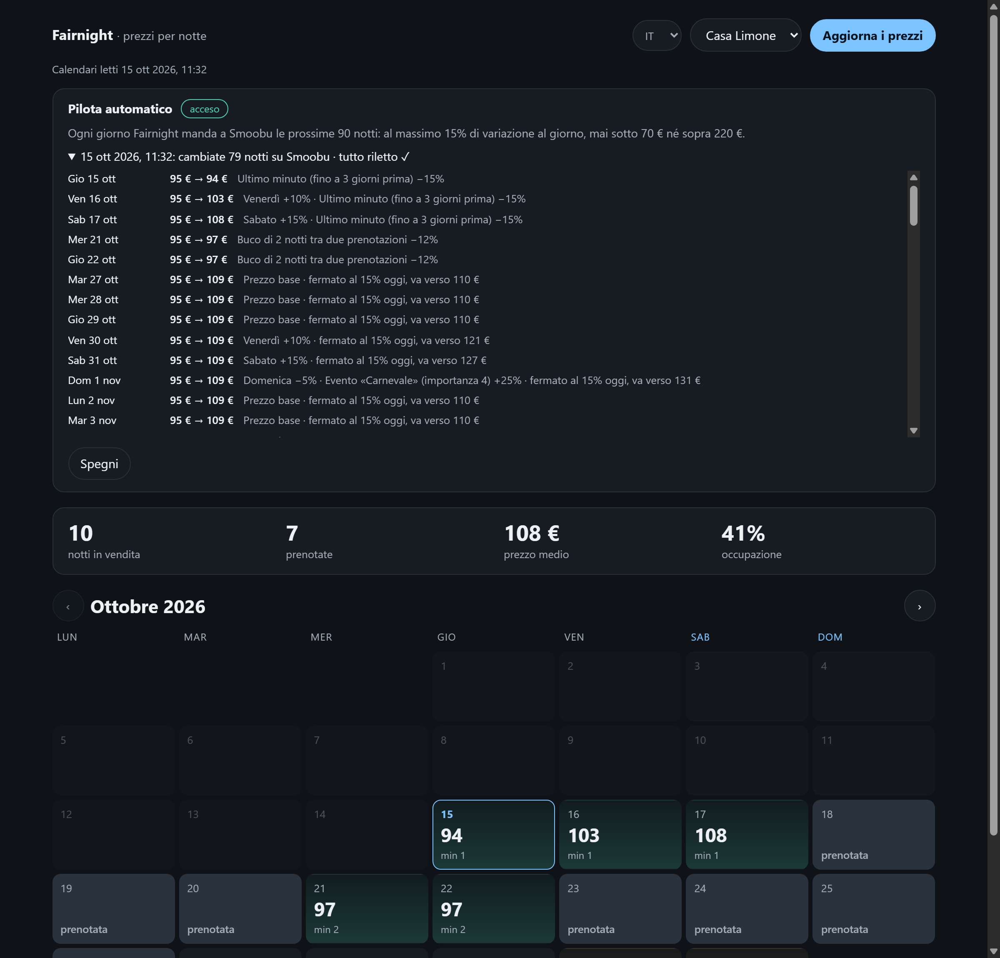

# OpenStay

Open-source tools for holiday rental hosts that run on the host's own computer: no account, no monthly fee, no server of ours holding their data. AGPL-3.0, TypeScript, Node.js.

**Fairnight** prices every night of the coming year.
It reads the host's calendars and rules, gives each night a price and a minimum stay, and explains every step that led there.
With Smoobu or Beds24 connected it writes the prices back, after the host confirms, or every day on autopilot where the host turned it on.

**Fairguest** registers guests with the authorities.
Spain (SES.HOSPEDAJES rules, the Mossos d'Esquadra file) and Italy (Alloggiati Web, regional Istat data): a check-in form for the guests, deadlines, and erasure when the law allows.
Guest data is encrypted on the host's computer with a passphrase only the host knows.
It also computes the tourist tax of each stay, with the month or quarter summary for the town, and, with the host's own Stripe account, lets the guest pay it and leave a deposit as a hold on the card; off by default ([guide](docs/tassa-pagamenti.md), Italian).

**Fairhello** drafts replies to guests.
It reads guest messages from Smoobu or Beds24 and writes a draft from the host's own house file, with the host's model key or a model running locally.
The host approves every reply before it is sent; a draft never contains a price.

## Screenshots

All data in the screenshots is invented.


| Autopilot: last run and why each night changed | Check-in form on a phone | Check-in link: the document read in the browser |
|---|---|---|
|  |  |  |

## Install in a minute

You need [Node.js](https://nodejs.org) 22 or newer (20 works where a C++ compiler is installed, because the SQLite module is precompiled only from Node 22 on).

**Hosts, Windows or Mac.** Download `Fairnight-installa.zip` from the [latest release](https://github.com/vladIDH/openstay/releases/latest), extract it and double-click `Installa Fairnight (Windows).cmd` or `Installa Fairnight (Mac).command`. The installer checks Node.js, installs Fairnight in `~/Fairnight`, asks a few questions in Italian, leaves a short guide in Italian or Spanish in the folder and opens the calendar page. Running it again updates Fairnight and keeps the settings. Step-by-step guide with screenshots, in Italian: [docs/installa.md](docs/installa.md).

**With npm:**

```
npm install -g fairnight-cli
fairnight init my-rentals
cd my-rentals
# put your iCal links and prices in fairnight.config.json
fairnight sync
fairnight serve        # http://localhost:4321
```

**From source:**

```
git clone https://github.com/vladIDH/openstay.git
cd openstay
npm install
npm run check          # typecheck, lint, tests and build of every package
node packages/fairnight-cli/bin/fairnight.js init ../my-rentals
```

## Architecture

An npm workspace. The libraries are pure: no network, no files, no clock ("today" is an input). Everything that touches the outside world lives in the command line package.

```
packages/
  fairnight          pricing engine: price, minimum stay and explanation per night (no runtime dependencies)
  fairguest          guest registration: rules per country, deadlines, retention, encryption, authority files
  fairhello          guest replies: house file, request to the model, freshness, price check
  fairnight-smoobu   Smoobu API client (HMAC request signing, rate limit)
  fairnight-beds24   Beds24 API v2 client (refresh token, credit budget)
  fairnight-market   zone data readers (host CSV, Inside Airbnb files, ISTAC open data)
  fairnight-cli      the `fairnight` command, SQLite storage, the local web pages
  fairnight-mcp      read-only MCP server over stdio
  fairguest-relay    optional relay for the check-in link (Cloudflare Worker, not published on npm)
```

- **Local SQLite.** The host's folder holds `fairnight.config.json` and `data/fairnight.db` ([better-sqlite3](https://github.com/WiseLibs/better-sqlite3)). The schema is versioned and migrated in place on first use. Guest details are sealed per value (X25519 + AES-256-GCM, key locked with scrypt) before they reach the database.
- **Local web pages.** `fairnight serve` serves the calendar page, the check-in form, the replies page and the payments page from the host's computer, with a strict Content-Security-Policy and nothing loaded from other sites. It listens on `127.0.0.1` unless `--lan` is given (so guests and the host's phone can reach it on the home network). Changing settings, switching the autopilot, sending replies and keeping or releasing a deposit work only from the computer itself; the check-in form needs a random per-stay code.
- **MCP.** `fairnight-mcp` opens the database read-only and exposes nine tools to Claude Desktop or any MCP client: `list_listings`, `get_prices`, `explain_night`, `occupancy`, `next_gaps`, `get_sync_status`, `get_market_area`, `get_guest_deadlines`, `get_guest_replies`. Fairguest's guest details are never returned; message texts only when a tool is asked for them. Setup: [packages/fairnight-mcp](packages/fairnight-mcp).
- **Deterministic engine.** Same input, same output. A regression test prices 365 nights and compares them with a fixture.

## Connectors

| Source | Reads | Writes |
|---|---|---|
| **iCal** (Airbnb, Booking.com, Vrbo and most channel managers) | bookings and blocked dates | nothing: export a CSV of prices instead |
| **Smoobu** (API key and secret, HMAC-signed requests) | apartments, bookings, rates, guest messages | prices and minimum stays after a confirmation; replies the host approved |
| **Beds24** (API v2, invite code → refresh token) | rooms and units, bookings, calendar, guest messages | prices and minimum stays after a confirmation; replies the host approved |

Credentials are asked without echo, saved readable by the current user only, and never logged. Details and limits: [docs/connettori.md](docs/connettori.md) (Italian). There is no scraping and there are no unofficial APIs, ever.

## What it does not do

- **Nothing is sent by itself.** Every write to a channel manager, every reply to a guest and every communication to the authorities is shown first and needs the host's confirmation. The only exceptions are ones the host switches on per listing: the price autopilot (within daily limits, read back after writing) and unattended sending to Alloggiati Web (`autoSend`).
- **No cloud of ours.** No account, no telemetry, no analytics. The only requests go to the calendar links, channel managers, model providers, authority services and the Stripe account the host configured; no payment passes through us. The one exception is optional: the remote check-in link passes through a relay that stores only data sealed in the guest's browser, deletes it once downloaded, and anyone can run their own; it is not deployed yet.
- **No market data by default.** Remote zone data sources are off unless the host switches them on with their own key or downloaded files.
- **No direct connection to Airbnb or Booking.com**, which require partner agreements.

## Status

0.2.0 is the first version published on npm. Fairnight's engine, iCal, Smoobu and Beds24 are tested against fake servers; the first writes to a real Smoobu and Beds24 account still check how each service treats the end of a date range. Fairguest's SES.HOSPEDAJES sending waits for the Ministry's schemas. What changed: [CHANGELOG.md](CHANGELOG.md). Host guides are in Italian and Spanish in [docs/](docs).

## Contributing

Bug reports, ideas and pull requests are welcome: read [CONTRIBUTING.md](CONTRIBUTING.md). Security problems: [SECURITY.md](SECURITY.md), not a public issue.

## License

[AGPL-3.0-only](LICENSE). You can use, study, change and share OpenStay. If you offer a modified version to others, including as an online service, you must share your changes under the same license.

Contact: [hello@khlumen.com](mailto:hello@khlumen.com).
