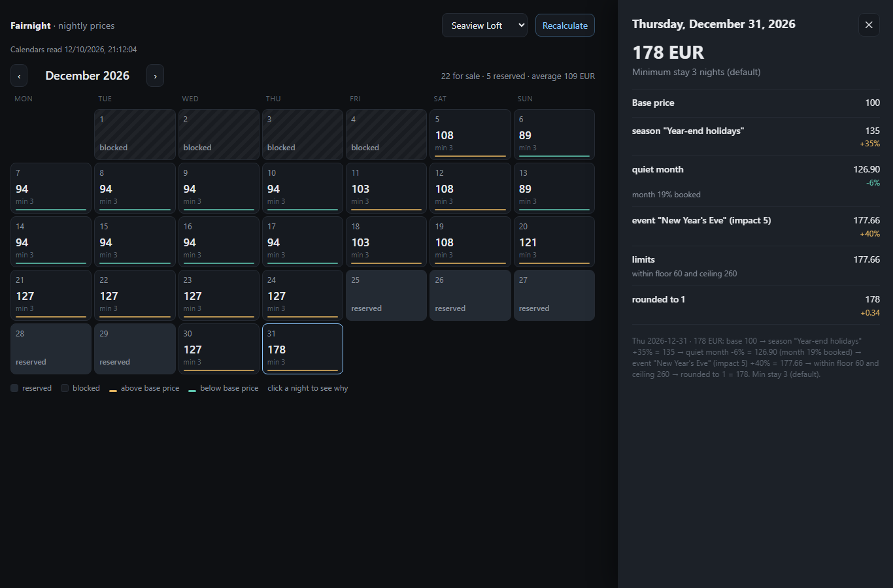

# OpenStay · Fairnight

**Fair nightly prices for your holiday rental, worked out on your own computer.**

Fairnight looks at your Airbnb, Booking.com and Vrbo calendars and at the rules you set. It then gives every night of the coming year a price and a minimum stay, and tells you **why**:

> Sat 13 Feb · 230 EUR: base 100 → season "Carnival week" = 160 → Saturday +15% = 184 → event "Jazz weekend" +25% = 230 → within floor 60 and ceiling 260. Min stay 3.

It is free and open source (AGPL-3.0). It has no account, no monthly fee per listing, and it does not send your data anywhere.



## What it does

- **Reads your calendars** through the iCal links that Airbnb, Booking.com, Vrbo and most channel managers give you.
- **Prices every night** from your rules:
  - base price, floor and ceiling;
  - seasons and weekdays;
  - last-minute discounts and far-ahead premiums;
  - gaps between two stays;
  - how full the month is;
  - your local events;
  - last year's prices;
  - a discount when no booking has come in for a while.
- **Sets the minimum stay** too: shorter close to the date, longer far ahead, and lowered so a single booking can fill a gap.
- **Explains each price**, step by step.
- **Shows a calendar page** in your browser, on your computer or your phone.
- **Exports a CSV** (date, price, minimum stay) to upload where you need it.
- **Answers questions in Claude** through an optional read-only MCP server: "which gaps do I have before Christmas?"

What it does **not** do (yet): it does not change prices on Airbnb or Booking.com by itself. You copy the prices or upload the CSV, or, with Smoobu or Beds24, confirm and let Fairnight write them (0.2.0, see below). More channel managers come in phase 2.

## Five-minute setup

You need [Node.js](https://nodejs.org) 20 or newer (free; the installer takes a minute).

```
npm install -g fairnight-cli
fairnight init my-rentals
cd my-rentals
```

1. Open `fairnight.config.json`. Replace the two example listings with yours:
   - a short name;
   - the iCal links from your channels;
   - your base, minimum and maximum price.
2. Read your calendars: `fairnight sync`
3. Open the calendar page: `fairnight serve`, then go to http://localhost:4321

Details, with where to find the iCal links on each channel, are in [fairnight-cli](packages/fairnight-cli).

## The commands

| Command | What it does |
|---|---|
| `fairnight init my-rentals` | Creates your folder with an example to copy from. |
| `fairnight sync` | Reads your calendars again. Safe to run as often as you like. |
| `fairnight price` | Prints every night with its price, minimum stay and reason (`--explain` for the full story). |
| `fairnight serve` | The calendar page (`--lan` to open it from your phone). |
| `fairnight export` | A CSV with date, price and minimum stay. |
| `fairnight import prices.csv --listing <name>` | Last year's prices, for the historical floor. |

## Smoobu

If you use [Smoobu](https://www.smoobu.com), Fairnight can read your apartments and bookings straight from it, and write prices and minimum stays back. It writes only after you have seen the differences and confirmed. *In development for 0.2.0.*

```
fairnight smoobu collega          # asks for your Smoobu API key and secret (never shown, never in the shell history)
fairnight smoobu importa          # your Smoobu apartments become listings, bookings come in
fairnight smoobu spingi           # shows what would change; add --applica to write it to Smoobu
```

The connector uses only Smoobu's HMAC request signing: create the API key **with its secret** in *Settings → Advanced → API Keys*. The old key-only login stops working on 31 October 2026 and is not used. After `importa`, `fairnight sync` reads Smoobu too.

## Beds24

If you use [Beds24](https://beds24.com), Fairnight reads your rooms and bookings from it, and writes prices and minimum stays back only after you have seen the differences and confirmed. *In development for 0.2.0.*

```
fairnight beds24 collega          # asks for a Beds24 invite code (never shown) and keeps the refresh token
fairnight beds24 importa          # each Beds24 room becomes a listing, bookings come in
fairnight beds24 spingi           # shows what would change; add --applica to write it to Beds24
```

- **Permissions.** Create the invite code in *Settings → Marketplace → API* with the permissions **read:bookings, all:inventory and read:properties**. They are chosen when the code is created and cannot be changed later.
- **Token lifetime.** The invite code works once, for 24 hours. The refresh token it gives **stops working after 30 days without use**, so run a Beds24 command at least once a month.
- **Credits.** Beds24 counts credits (100 every 5 minutes by default). Fairnight never uses more than half of them and prints, after each command, how many it used and how many are left.
- **Rooms with several identical units** are not handled yet.

## Fairguest: guest registration in Spain

*0.1.0, in development.* Spanish law (Real Decreto 933/2021) asks every host to send the police the details of each guest, within 24 hours. Fairguest does this on your computer, with no account and no server of ours in between:

- **a check-in form** your guests fill in on a phone or tablet, on your own Wi-Fi only, in Spanish, English or Italian;
- **the details kept encrypted** with a passphrase only you know;
- **the deadlines** of every booking and arrival, with late ones flagged;
- **the file for the Mossos d'Esquadra** (Catalonia), ready to upload;
- **automatic erasure** when the law no longer requires the data.

Sending to SES.HOSPEDAJES (the rest of Spain) comes when the Ministry's schemas are in hand. Until then you enter the guests on its website, and Fairguest keeps the deadlines and the record.

```
fairnight ospiti attiva                  # choose the passphrase
fairnight serve --lan                    # the check-in forms open on your network
fairnight ospiti                         # what is due and what is late
```

**If you lose the passphrase, the guests' data cannot be recovered by anyone.** The whole guide is in [fairnight-cli](packages/fairnight-cli#guest-registration-fairguest-010-in-development).

## Fairnight today and PriceLabs

PriceLabs is a mature, paid service with market data from millions of listings. Fairnight is a first version that works only with **your** data. This is where it stands, compared with PriceLabs' public feature pages:

| Feature | PriceLabs | Fairnight today | Coming in |
|---|---|---|---|
| Base price, floor and ceiling, rounding | ✓ | ✓ | — |
| Seasons, day of week | ✓ | ✓ | — |
| Last-minute discount, far-ahead premium | ✓ | ✓ (steps you choose) | market-driven version: phase 3 |
| Gap (orphan night) pricing and minimum stay | ✓ | ✓ | — |
| Minimum stay by lead time | ✓ | ✓ | computed minimum stay: phase 3 |
| Occupancy adjustment | ✓ | ✓ (per month) | portfolio-wide: phase 2 |
| Historical floor | ✓ | ✓ (same month last year) | — |
| Discount when no bookings arrive | ✓ | ✓ | — |
| Events | curated list, users can only suggest | ✓ your own events file | public holidays file: phase 2 |
| Date overrides | ✓ | ✓ | — |
| Explanation of each price | tooltip | ✓ every step, reproducible | — |
| Calendar page | ✓ | ✓ local | — |
| AI assistant connection (MCP) | ✓ | ✓ read-only, local | write access with confirmation: phase 2 |
| Rules per group / portfolio, reusable rule sets | ✓ | — | phase 2 |
| Length-of-stay discounts, extra-guest fees, check-in days | ✓ | — | phase 2 |
| Pushing prices to channel managers | ✓ 160+ | CSV export; Smoobu and Beds24 in 0.2.0, with confirmation | more connectors: phase 2 |
| Alerts, portfolio reports, pacing vs last year | ✓ | — | phase 2 |
| Try the rules on last year first (backtest) | preview of new rules only | — | phase 2 |
| Market data: neighbourhood prices, comp sets | ✓ | — | phase 3, optional, with your own data key |
| Price per listing | about $20 a month (third-party sources) | free | — |
| Your data | in their cloud | on your computer | — |

Direct connections to Airbnb and Vrbo need partner agreements, and OpenStay will never scrape any website.

## Privacy

Everything stays in your folder: your rules, your calendars, your prices. The only internet requests go to the calendar links you write yourself, and to Smoobu or Beds24 if you connect them. Pricing never stores guest names, phone numbers or messages. If you use Fairguest, your guests' details are stored in the same folder, encrypted with your passphrase, and erased as soon as the law allows. There is no account, no tracking and no telemetry.

## The packages

| Package | For whom |
|---|---|
| [`fairnight-cli`](packages/fairnight-cli) | Hosts: the `fairnight` command and the calendar page. |
| [`fairnight-mcp`](packages/fairnight-mcp) | Hosts who use Claude Desktop or another MCP client. |
| [`fairnight`](packages/fairnight) | Developers: the pricing engine as a pure library (no network, no files). |
| [`fairguest`](packages/fairguest) | Developers: guest registration as a pure library (rules, deadlines, retention, encryption, the Mossos file). |

## Contributing

Bug reports, ideas and pull requests are welcome: see [CONTRIBUTING.md](CONTRIBUTING.md). Security issues: see [SECURITY.md](SECURITY.md). What changed in each version: [CHANGELOG.md](CHANGELOG.md).

Contact: [hello@khlumen.com](mailto:hello@khlumen.com).

## License

[AGPL-3.0](LICENSE). You can use, study, change and share Fairnight. If you offer a modified version to others, including as an online service, you must share your changes under the same license.
