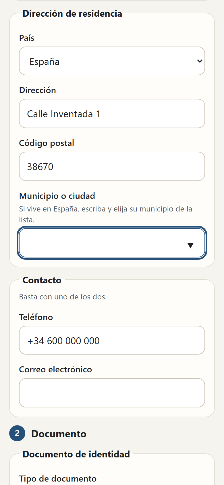
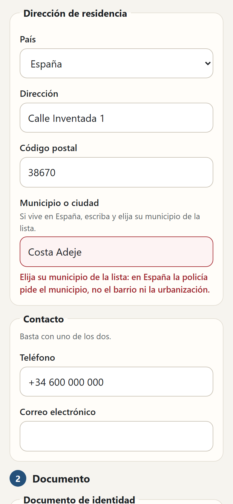
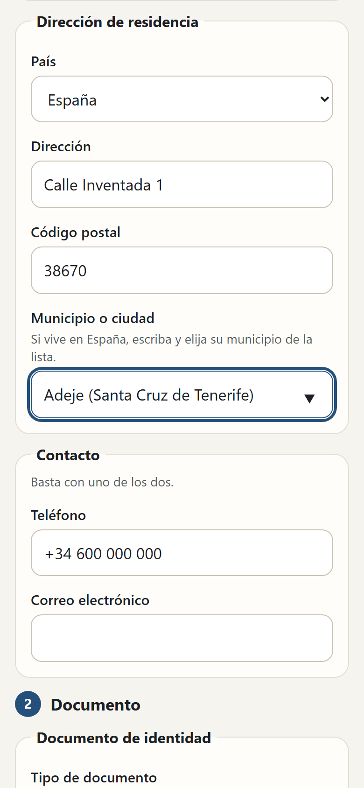
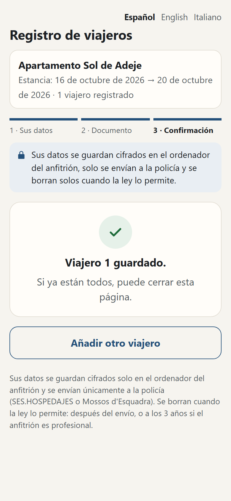

# Fairguest in Spagna: il link per l'ospite e la foto del documento

In Spagna Fairguest prepara la comunicazione dei viaggiatori (Real Decreto 933/2021). Vale per:
- **SES.HOSPEDAJES**, con `"country": "ES"`;
- i **Mossos d'Esquadra** in Catalogna, con `"country": "ES-CT"`.

Dati e scadenze sono in [registro-ospiti.md](registro-ospiti.md) e nel README di fairnight-cli. Questa guida spiega il **link** che funziona da qualsiasi posto e la **foto del documento**: sono gli stessi dell'Italia.

> Versione in sviluppo (ottobre 2026). Non è un parere legale. I punti **[NV]** non sono ancora verificati con un uso vero.

[Versión en español](fairguest-espana.es.md)

## Il link

```
fairnight ospiti link <soggiorno>
```

Stampa un indirizzo da mandare all'ospite, valido fino a due giorni dopo il check-out.

**Cosa fa l'ospite**
- Compila il modulo di sempre, con le domande del Real Decreto 933/2021: indirizzo, telefono o email, tipo di pagamento (solo il tipo).
- Il suo telefono cifra ogni ospite con la chiave pubblica della tua cartella Fairguest prima di spedirlo.

**Cosa fa il tuo computer**
- Scarica gli ospiti e li cancella dal servizio:
  - con `fairnight ospiti scarica`;
  - da solo ogni 5 minuti con `fairnight serve` acceso;
  - prima di `ospiti elenco`.
- Non apre porte.

**Controllo della pagina:** `fairnight ospiti verifica-pagina` confronta i file serviti con quelli di questa versione.

Il dettaglio su cosa vede chi gestisce il servizio, e su come ospitarlo da sé, è in [fairguest-italia.md](fairguest-italia.md#il-link-da-mandare-allospite) e in [packages/fairguest-relay/README.md](../packages/fairguest-relay/README.md).

## La foto del documento

L'ospite fotografa le righe con lettere e `<<<`: sul retro del **DNI**, in fondo alla pagina con la foto del **passaporto**.

**DNI spagnolo**
- Nella MRZ c'è il numero di supporto dove di solito sta il numero del documento.
- Il numero di DNI sta nei dati facoltativi.
- Fairguest mette ciascuno nel suo campo e divide i due cognomi.

**Altri documenti**
- Un passaporto spagnolo segna «Passaporto rilasciato in Spagna».
- Le carte d'identità straniere diventano «Altro documento d'identità».

**La foto**
- Viene letta sul telefono e non viene mai inviata né salvata, come chiede l'AEPD.
- Se una cifra di controllo non torna, l'ospite vede un avviso e controlla i dati.

Schermata con dati inventati: [DNI letto per un alloggio in Catalogna](images/link/link-es-dni-leido.png).

## Il comune di residenza

Per chi vive in Spagna, SES e i Mossos vogliono il **codice INE del comune**. L'ospite non lo conosce, quindi il modulo chiede il comune per nome:
- il campo «Municipio o ciudad» suggerisce gli 8.132 comuni della tabella ufficiale dell'INE (1° gennaio 2026), anche senza JavaScript;
- maiuscole e accenti non contano, l'articolo può stare davanti o dietro («Las Palmas de Gran Canaria»), e i nomi bilingui rispondono a ciascuna metà («San Sebastián», «Donostia»);
- se due comuni hanno lo stesso nome, decide il codice postale (le prime due cifre sono la provincia);
- una località che non è un comune (un quartiere, «Costa Adeje») viene rifiutata con un messaggio che chiede di sceglierlo dall'elenco.

Fairguest salva il codice completo di 6 cifre (provincia, comune, cifra di controllo; Adeje 380012), come lo chiede il file dei Mossos (manuale v8, campo 29). Per SES si usano le prime 5 (38001), come dicono le istruzioni SES («códigos de municipios del INE (5 dígitos)»). L'host non deve più correggere niente. Con `fairnight ospiti correggi … address.municipalityCode` si possono scrivere 5 o 6 cifre: un codice che non esiste viene rifiutato.

| Il campo | Non è un comune | Scelto | Salvato |
|---|---|---|---|
|  |  |  |  |

La tabella si aggiorna una volta l'anno: si scarica a mano `NNcodmun.xlsx` dall'INE e si lancia `node packages/fairguest/scripts/es-municipalities.mjs <file> <anno>`.

## Dopo

**Mossos d'Esquadra**
- `fairnight ospiti prepara` scrive il file per il portale.
- Provato con un ospite arrivato dal link: DNI, supporto e cognomi vanno nei campi giusti.

**SES.HOSPEDAJES**
- Resta in attesa degli XSD del Ministero.
- Intanto i dati si copiano sul sito SES e si registra l'invio con `fairnight ospiti inviato`.

**[NV]**
- precisione della lettura su foto vere;
- DNI di vecchio modello e TIE.
