# Installare Fairnight sul tuo computer

Questa guida è per chi affitta da 1 a 10 case su Airbnb, Booking o Vrbo e non ha mai usato un terminale. Ci vogliono circa 15 minuti, la prima volta.

## Cosa fa Fairnight, e cosa no

**Fa:**

- legge i calendari delle tue case da Airbnb, Booking e Vrbo (con i «link iCal», gli stessi che usi per sincronizzare i calendari tra le piattaforme);
- calcola un prezzo per ogni notte dei prossimi 12 mesi. Parte dal tuo prezzo base, lo alza in alta stagione e nei fine settimana e lo abbassa sulle notti vicine rimaste libere e sui buchi tra due prenotazioni. Non scende mai sotto il tuo minimo e non sale mai sopra il tuo massimo;
- ti mostra tutto in un calendario nel browser. Clicchi una notte e vedi perché ha quel prezzo.

**Non fa:**

- **non cambia i prezzi su Airbnb, Booking o Vrbo.** Con i link iCal Fairnight può solo leggere le date occupate, non scrivere i prezzi. I prezzi li copi tu sulle piattaforme. Oppure, se usi Smoobu o Beds24, glieli manda Fairnight e loro li passano alle piattaforme: vedi [connettori.md](connettori.md);
- non guarda i prezzi delle case vicine e non entra nei tuoi account: non gli dai nessuna password;
- non lavora da solo in sottofondo: calcola quando apri il calendario o premi «Aggiorna i prezzi».

**Dove stanno i tuoi dati:** solo sul tuo computer, nella cartella `Fairnight` del tuo utente: `C:\Users\<tuo nome>\Fairnight` su Windows, `/Users/<tuo nome>/Fairnight` su Mac. Fairnight si collega a internet solo per leggere i link iCal che gli dai. Non abbiamo un server e non riceviamo niente.

## Cosa ti serve

- Un computer con **Windows 10 o 11**, oppure un **Mac** con macOS recente.
- **Node.js**, un programma gratuito che fa funzionare Fairnight, nella versione 22 o più recente. Se non ce l'hai, l'installazione te lo dice e ti spiega come metterlo: vedi il passo 2.
- I **link iCal** delle tue case: al passo 4 trovi dove prenderli.

## 1. Scarica Fairnight

- **Se sei tra i primi a provarlo** ti abbiamo invitato al progetto su GitHub. Apri la pagina del progetto, clicca il pulsante verde **Code** e poi **Download ZIP**.
- **Dopo il lancio** basterà scaricare `Fairnight-installa.zip` dalla pagina [Releases](https://github.com/vladIDH/openstay/releases/latest).

Apri lo zip scaricato ed estrai la cartella: su Windows tasto destro › **Estrai tutto**. Su Mac basta un doppio clic.

## 2. Node.js, se non ce l'hai

Se non sai se ce l'hai, vai pure al passo 3: se manca, l'installazione si ferma e mostra questo messaggio.

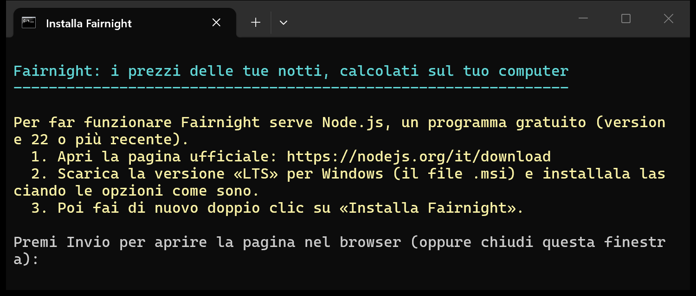

1. Apri la pagina ufficiale [nodejs.org/it/download](https://nodejs.org/it/download).
2. Scarica la versione **LTS**: su Windows il file `.msi`, su Mac il file `.pkg`. Installala lasciando tutte le opzioni come sono.
3. Rifai il passo 3.

Se hai già Node.js ma è vecchio (prima della 22), il messaggio te lo dice: installa la LTS sopra quella vecchia.

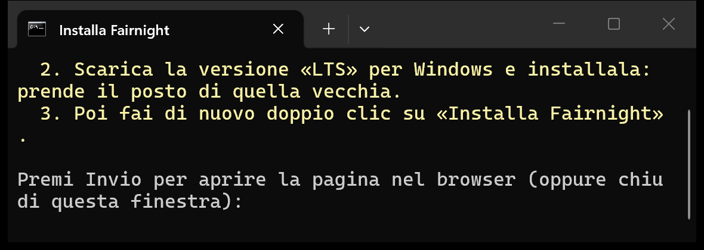

## 3. Installa

### Su Windows

Nella cartella estratta fai doppio clic su **Installa Fairnight** (il file `Installa Fairnight.cmd`).

Windows può avvisarti che non riesce a verificare l'autore. È normale per i programmi gratuiti che non pagano un certificato di firma. Clicca **Esegui**.

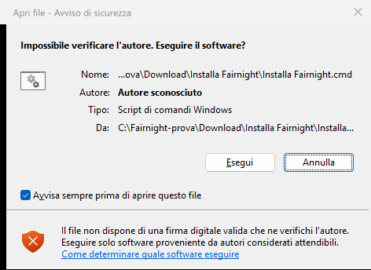

Se invece compare la finestra blu **«Windows ha protetto il PC»**, clicca **Ulteriori informazioni** e poi **Esegui comunque**. Il motivo è lo stesso.

<!-- SCHERMATA DA AGGIUNGERE: la finestra blu «Windows ha protetto il PC» con «Ulteriori informazioni» e «Esegui comunque». Sul computer di prova Windows ha mostrato solo l'avviso qui sopra. -->

Si apre una finestra nera: Fairnight si installa da solo, in 1-4 minuti.

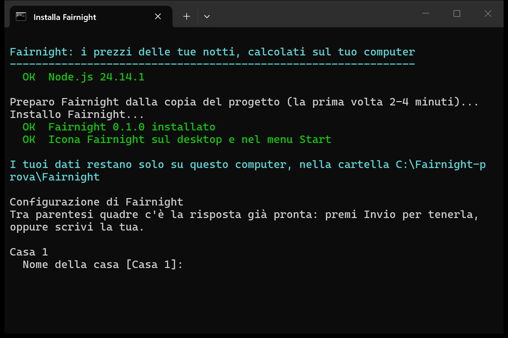

### Su Mac

Nella cartella estratta **non** fare doppio clic: fai **tasto destro** (o Ctrl+clic) su **Installa Fairnight** (il file `Installa Fairnight.command`), scegli **Apri** e poi di nuovo **Apri** nella finestra che compare. Il Mac lo chiede ogni volta che apri per la prima volta un programma gratuito non firmato da uno sviluppatore registrato da Apple. È normale e serve solo la prima volta.

Se il Mac non ti dà il pulsante **Apri** e dice solo che non può verificare il file: chiudi l'avviso, apri **Impostazioni di Sistema › Privacy e sicurezza**, scorri in basso fino al messaggio su «Installa Fairnight.command» e clicca **Apri comunque**. Succede sulle versioni più recenti di macOS.

<!-- SCHERMATA DA AGGIUNGERE (Mac): il menu del tasto destro su «Installa Fairnight.command» con «Apri», e la finestra di conferma con il pulsante «Apri». -->

Si apre il Terminale: Fairnight si installa da solo, in 1-4 minuti. Le domande e i messaggi sono gli stessi che vedi nelle schermate di Windows.

## 4. Rispondi alle domande

Alla fine dell'installazione Fairnight ti fa qualche domanda. Tra parentesi quadre c'è una risposta già pronta: premi **Invio** per tenerla, oppure scrivi la tua e premi Invio.

1. **Nome della casa**: come la chiami tu, per esempio «Casa Limone».
2. **Città o paese**: serve per proporti le stagioni.
3. **Link iCal di Airbnb, Booking e Vrbo**: incolla il link con **Ctrl+V** su Windows, **Cmd+V** su Mac (oppure tasto destro). Se la casa non è su una piattaforma, premi Invio. Fairnight legge subito ogni link e ti dice quante prenotazioni ha trovato. Se il link non funziona, te lo dice e puoi incollarlo di nuovo.

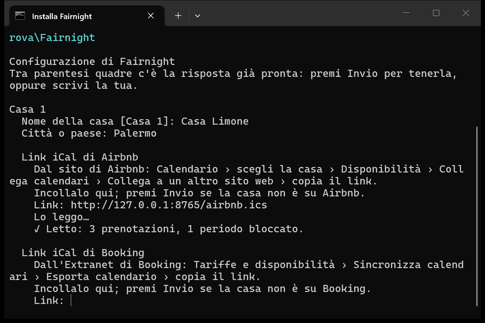

**Dove trovi i link iCal** (dal computer, non dall'app; i nomi dei menu possono cambiare un poco):

- **Airbnb**: Calendario › scegli la casa › Disponibilità › Collega calendari › Collega a un altro sito web › copia il link.

  <!-- SCHERMATA DA AGGIUNGERE: Airbnb, finestra «Collega a un altro sito web» con il link da copiare (dati veri sfocati). -->
- **Booking**: Extranet › Tariffe e disponibilità › Sincronizza calendari › Esporta calendario › copia il link.

  <!-- SCHERMATA DA AGGIUNGERE: Booking Extranet, «Sincronizza calendari» con il link di esportazione (dati veri sfocati). -->
- **Vrbo**: sito per proprietari › Calendario › Importa ed esporta › Esporta calendario › copia il link.

  <!-- SCHERMATA DA AGGIUNGERE: Vrbo, «Esporta calendario» con il link (dati veri sfocati). -->

Il link iCal è privato: chi lo ha vede quando la casa è occupata. Non pubblicarlo e non mandarlo a chi non conosci.

4. **Prezzo base**: il prezzo di una notte normale, in euro.
5. **Prezzo minimo e massimo**: Fairnight non va mai sotto il minimo né sopra il massimo. Se premi Invio, propone il 60% e il 250% del base.
6. **Stagioni**: Fairnight te le propone in base alla città, con le date. Alle Canarie l'alta stagione è l'inverno; nel resto d'Italia e della Spagna sono l'estate e Natale. Scrivi **s** per usarle così, **c** per cambiarle una per una (date e percentuali) o aggiungerne altre, per esempio Pasqua, **n** per non usarne. Niente viene applicato senza la tua conferma.

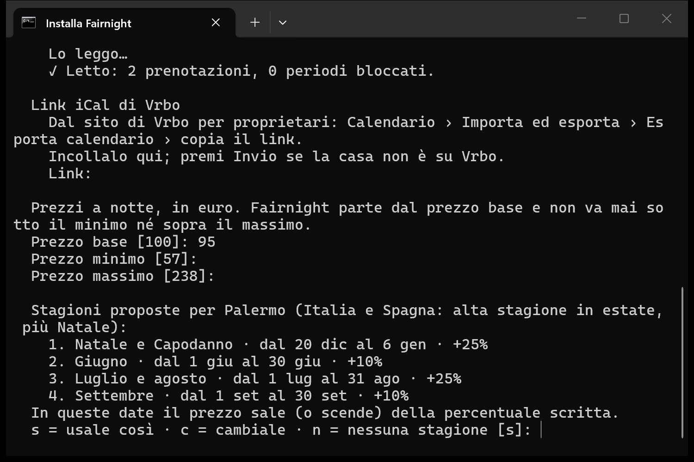

7. **Un'altra casa?** Scrivi **s** per aggiungerla e rispondi alle stesse domande, oppure premi Invio per finire.
8. **Lingua del calendario**: 1 Italiano, 2 Español, 3 English. Fairnight la propone in base alla città (Italia → italiano, Spagna e Canarie → spagnolo) o, se la città non basta, in base alla lingua del computer: premi Invio per tenerla. Se non c'è niente da proporre e premi Invio, il calendario resta in inglese. La domanda arriva una volta sola: dopo si cambia dal calendario stesso.

Il resto delle regole ha valori di partenza prudenti, che puoi cambiare dopo:
- fine settimana: venerdì +10%, sabato +15%, domenica -5%;
- notti vicine: -15% a 3 giorni, -8% a 7 giorni;
- buchi di 1-2 notti tra due prenotazioni: -12%;
- soggiorno minimo: 2 notti.

## 5. Il calendario

Fairnight legge i calendari e apre il calendario dei prezzi nel browser.

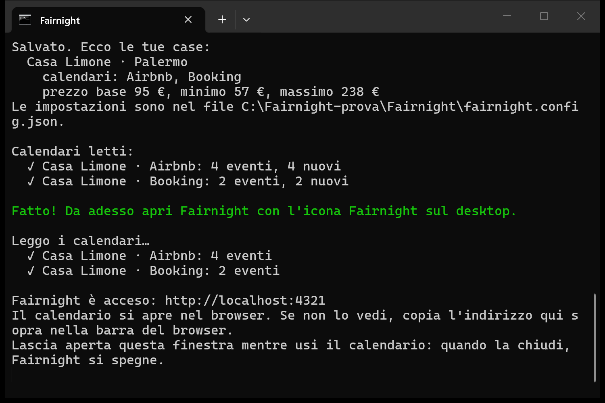

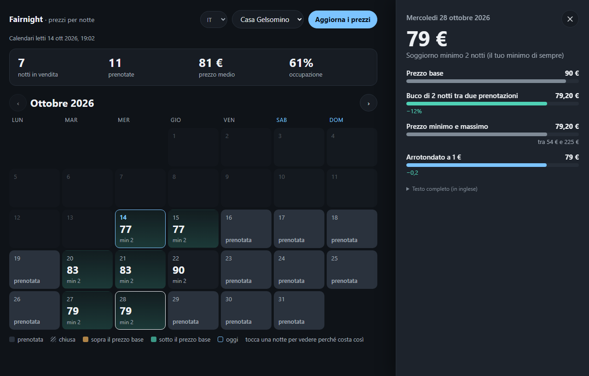

- In alto c'è il riassunto del mese: notti in vendita, prenotate, prezzo medio e occupazione.
- Ogni notte libera mostra il prezzo grande e il soggiorno minimo. Le notti sopra il prezzo base sono color ambra, quelle sotto verde acqua; le prenotate sono grigie, le chiuse a righe. Oggi ha un bordo azzurro, sabato e domenica hanno il nome colorato.
- Clicca una notte per vedere da dove viene il prezzo: in grande il prezzo finale, sotto una piccola scala di barre dal prezzo base al prezzo finale, con ogni regola spiegata con le sue parole (buco tra due prenotazioni, ultimo minuto, stagione, prezzo minimo e massimo…).
- I colori seguono il computer o il telefono: tema scuro se è scuro, chiaro se è chiaro.
- «Aggiorna i prezzi» rilegge i calendari e ricalcola.
- Il calendario parla italiano, spagnolo o inglese. Per cambiare lingua usa il piccolo menu **IT · ES · EN** in alto: la scelta resta in quel browser. In fondo al pannello di una notte, «Testo completo (in inglese)» apre la spiegazione originale di Fairnight: è quella da mandare se chiedi aiuto.

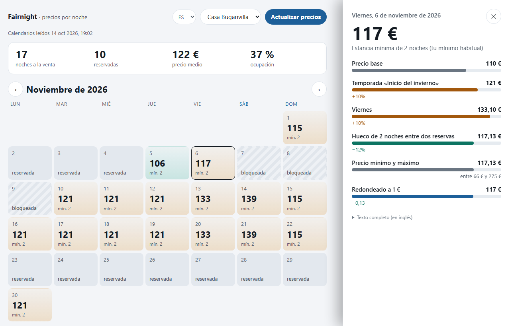

Dal telefono (con `fairnight serve --lan`, sulla stessa rete Wi-Fi) il calendario si stringe e il pannello della notte si apre dal basso:

| Il mese | Una notte |
|---|---|
| 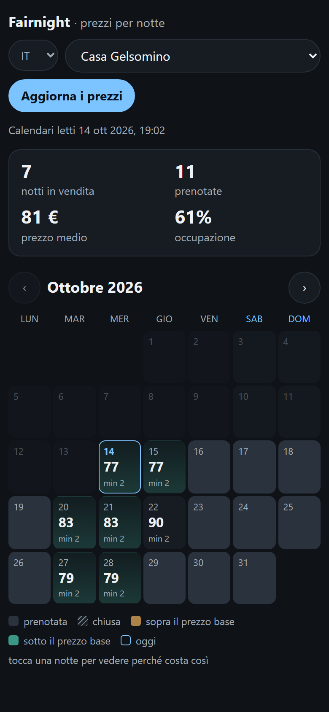 | 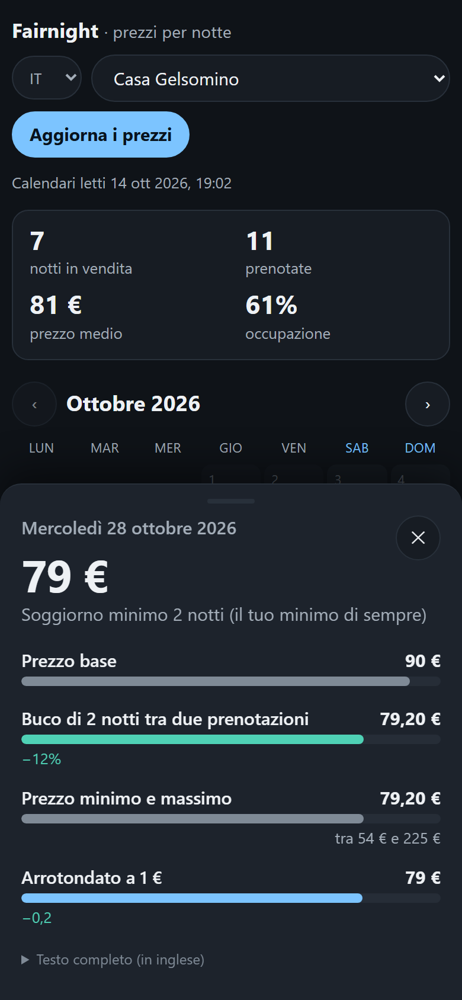 |

- **La finestra nera deve restare aperta** mentre usi il calendario: quando la chiudi, Fairnight si spegne. Puoi ridurla a icona.

**Le volte successive** non serve il terminale:

- **Windows**: doppio clic sull'icona **Fairnight** sul desktop (c'è anche nel menu Start: scrivi «Fairnight»).
- **Mac**: doppio clic su **Fairnight** sulla Scrivania, oppure cercalo con Spotlight (Cmd+Spazio, «Fairnight»). Per averlo nel **Dock**: apri il Finder, vai nella cartella Applicazioni del tuo utente (Vai › Inizio › Applicazioni) e trascina **Fairnight** nel Dock.

<!-- SCHERMATA DA AGGIUNGERE (Mac): l'app Fairnight nel Dock. -->

Se Fairnight è già acceso e fai di nuovo doppio clic sull'icona, si riapre solo il calendario.

## 6. Mettere i prezzi su Airbnb e Booking

Con i soli link iCal i prezzi li porti tu sulle piattaforme. Un modo semplice: una volta alla settimana guarda le prossime 4-8 settimane nel calendario e copia i prezzi che cambiano. Su Airbnb si fa da Calendario › scegli le date › Prezzo; sull'Extranet di Booking da Tariffe e disponibilità › Calendario.

Se usi **Smoobu** o **Beds24**, Fairnight può mandare i prezzi a loro e loro li passano a tutte le piattaforme: vedi [connettori.md](connettori.md). Per ora questa parte si attiva da terminale. Se ti interessa, scrivici e la configuriamo insieme.

## 7. Cambiare le impostazioni

Nella cartella `Fairnight` fai doppio clic su **Cambia impostazioni**. Fairnight ti mostra le tue case: scrivi il numero di quella da cambiare, **a** per aggiungerne una, **f** per finire. Rifà le stesse domande, con le risposte di adesso già pronte tra parentesi quadre: cambi solo quello che ti serve. Per togliere un link iCal scrivi `-` al posto del link.

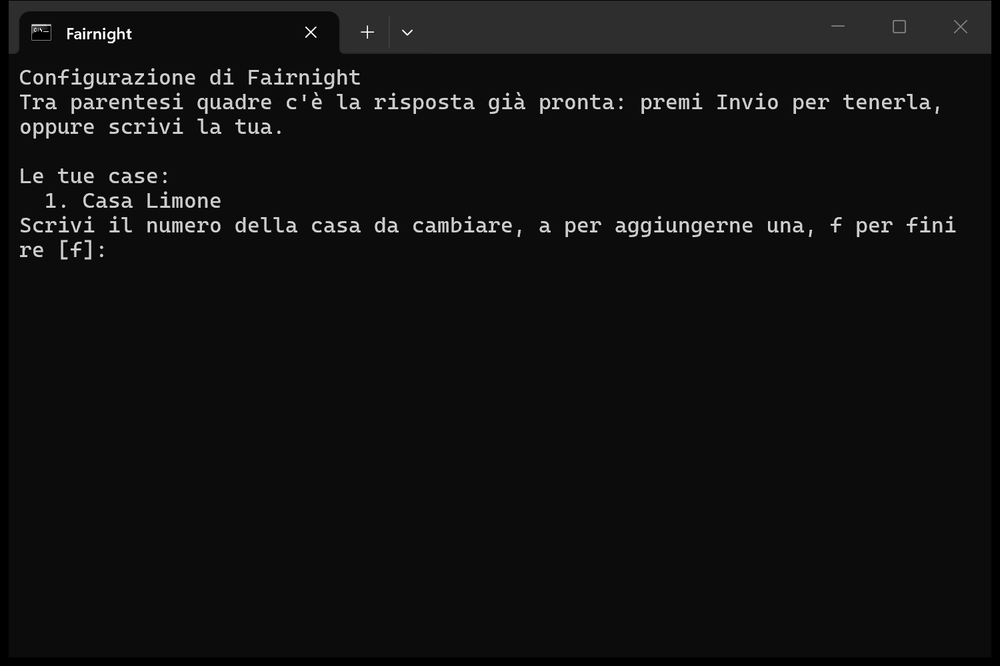

Le impostazioni sono nel file `fairnight.config.json`, nella stessa cartella. Prima di ogni modifica, quello vecchio resta in `fairnight.config.json.bak`. Le regole che le domande non toccano, per esempio i fine settimana o gli sconti sulle notti vicine, si cambiano in quel file. Se non ti senti sicuro, scrivici.

## 8. Aggiornare Fairnight

Scarica di nuovo lo zip (passo 1) e fai di nuovo doppio clic su **Installa Fairnight**. Fairnight si aggiorna e le tue impostazioni e i tuoi dati restano come sono.

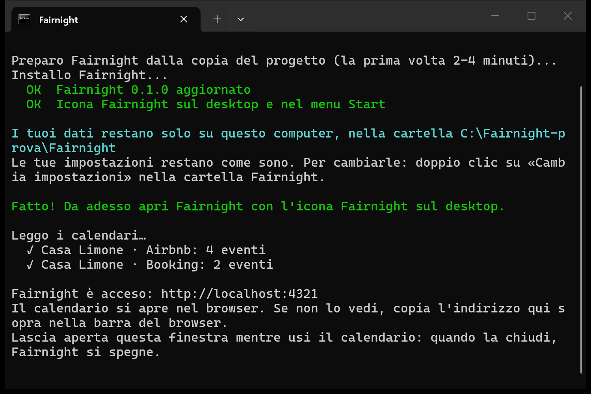

Se aggiorni Node.js a una versione nuova, per esempio dalla 22 alla 24, Fairnight può dirti «Fairnight non parte con questa versione di Node.js». In quel caso rifai l'aggiornamento come qui sopra.

## 9. Cosa c'è nella cartella Fairnight

| | |
|---|---|
| `Fairnight` | apre il calendario (è il file che usa l'icona) |
| `Cambia impostazioni` | le domande del passo 4, per cambiare le risposte |
| `fairnight.config.json` | le tue case, i link iCal e le regole dei prezzi |
| `data` | le prenotazioni lette dai calendari |
| `programma` | Fairnight stesso: non serve aprirla |
| `installazione.log` | il resoconto dell'ultima installazione: mandacelo se qualcosa non va |

Per una copia di sicurezza basta copiare `fairnight.config.json` e la cartella `data`.

## 10. Disinstallare

1. Chiudi la finestra di Fairnight, se è aperta.
2. Cancella la cartella `Fairnight` del tuo utente: `C:\Users\<tuo nome>\Fairnight` su Windows, la cartella Inizio › `Fairnight` su Mac. **Così cancelli anche le impostazioni e i dati.** Se vuoi tenerli, prima copia `fairnight.config.json` e la cartella `data`.
3. Cancella l'icona:
   - **Windows**: l'icona Fairnight sul desktop; per quella nel menu Start, tasto destro › Altro › Apri percorso file, e cancellala da lì;
   - **Mac**: Fairnight sulla Scrivania e nella cartella Applicazioni del tuo utente, e toglila dal Dock se ce l'hai messa.

Node.js puoi tenerlo o toglierlo come un programma qualsiasi: Fairnight non lo usa più.

## Se qualcosa non va

- **«Non riesco a leggerlo» su un link iCal**: controlla di aver copiato tutto il link. Quello di Airbnb finisce con `.ics` seguito da un codice. Se la piattaforma ha rigenerato il link, copia quello nuovo con «Cambia impostazioni».
- **Il calendario non si apre nel browser**: nella finestra nera c'è l'indirizzo, di solito `http://localhost:4321`. Copialo nella barra del browser.
- **«Non sono riuscito a installare Fairnight»**: mandaci il file `installazione.log` della cartella Fairnight. I tuoi dati non vengono toccati.
