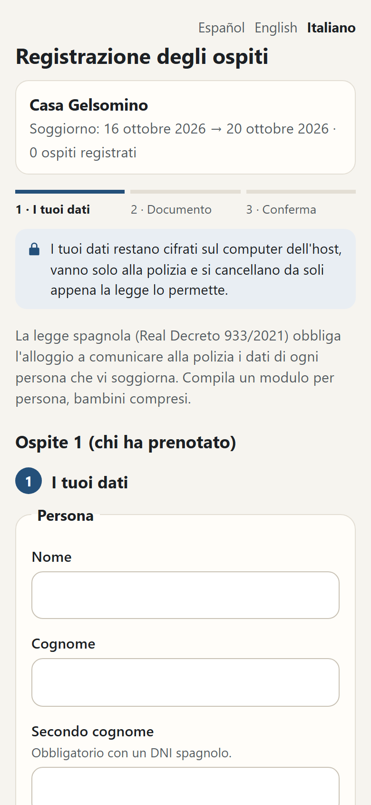
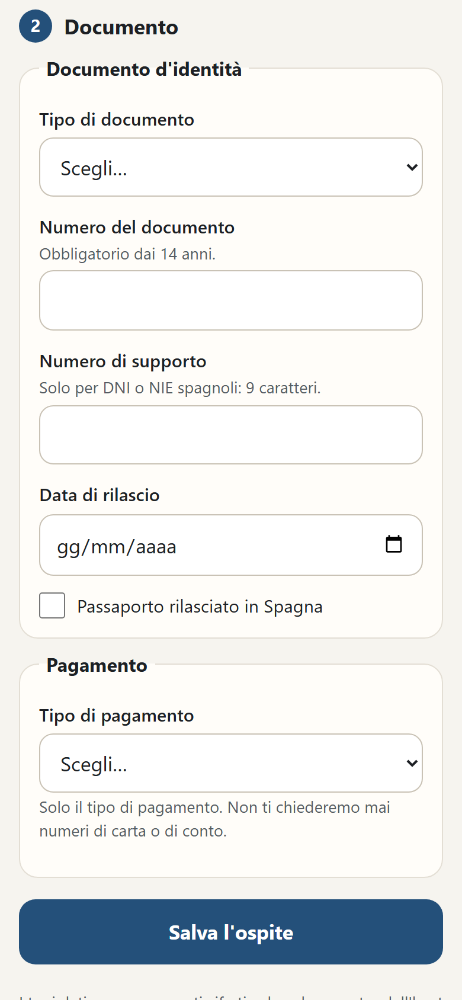
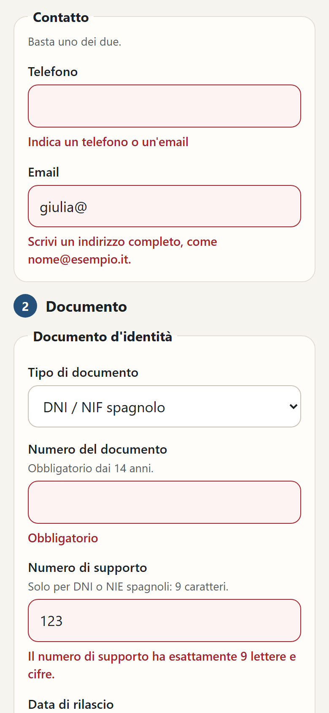
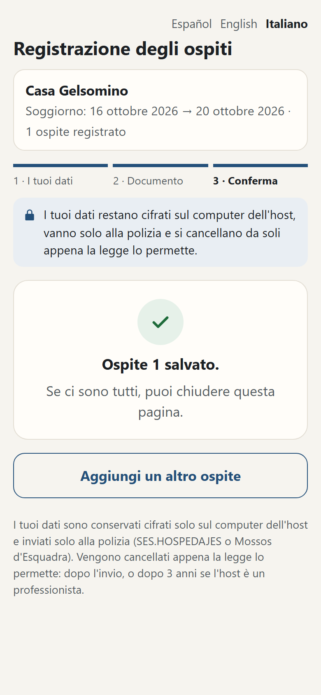

# Fairguest: registro degli ospiti

Fase 1 (ricerca e progetto) del 12 ottobre 2026, fatta solo su documentazione pubblica: nessuna iscrizione, nessuna chiamata ai servizi, nessuno scraping. **[NV]** = non verificato su fonte ufficiale. **Non è un parere legale.**

**Fase 2 (codice) iniziata il 13 ottobre 2026** sul ramo `fairguest`, con tutto quello che non dipende dagli schemi SES: lo stato è nella sezione 10.

OpenStay è il contenitore; Fairnight è il modulo dei prezzi. **Fairguest** è il secondo modulo: la comunicazione obbligatoria degli ospiti alle autorità.

## Decisioni (13 ottobre 2026)

- **Nome:** Fairguest (sezione 6).
- **Prima versione: solo Spagna**, cioè SES.HOSPEDAJES più il file da caricare sul portale dei Mossos per la Catalogna.
- **Versioni successive:** Italia (Alloggiati Web + Istat/ROSS1000) e Portogallo (SIBA). Tutto quello che abbiamo trovato è nella sezione 8.
- **15 ottobre 2026: si parte con l'Italia** (ramo `fairguest-it`). Alloggiati Web è nel codice: guida per l'host in [fairguest-italia.md](fairguest-italia.md) (italiano) e [fairguest-italia.es.md](fairguest-italia.es.md) (spagnolo). Istat, link a distanza e foto del documento seguono in PR separate. Per la Spagna, link e foto: [fairguest-espana.es.md](fairguest-espana.es.md) e [fairguest-spagna.md](fairguest-spagna.md).

## In breve

| | Spagna (SES.HOSPEDAJES): **prima versione** | Italia (Alloggiati Web): dopo | Portogallo (SIBA): dopo |
|---|---|---|---|
| Servizio | SOAP 1.1, XML zippato e in Base64, risposta asincrona per lotto | SOAP 1.2, righe a lunghezza fissa da 168 caratteri | SOAP, XML con XSD pubblico |
| Credenziali | utente e password del web service, separate da quelle del sito | utente + password + WSKEY → token di 1 ora | da UCFE **[NV]** |
| Ambiente di prova | endpoint di preproduzione pubblicato, accesso non documentato | nessuno: metodo `Test` che valida senza acquisire | sì, endpoint di sviluppo |
| Termine | 24 ore dalla prenotazione **e** dall'ingresso | 24 ore dall'arrivo, 6 ore se il soggiorno dura meno di 24 ore | — |
| Conservazione | 3 anni (host professionali) | ricevute 5 anni; i dati inviati vanno **cancellati** dopo la ricevuta | — |

---

## Il modulo che vede l'ospite

Il modulo di check-in (`/checkin/<codice>`) è pensato prima di tutto per il telefono e segue il tema chiaro o scuro del telefono dell'ospite. Ha tre passi sullo schermo (i tuoi dati, documento, conferma), un messaggio accanto a ogni campo da correggere e una riga in alto su cosa succede ai dati: cifrati sul computer dell'host, inviati solo alla polizia, cancellati da soli quando la legge lo permette. Schermate con dati inventati, in italiano e spagnolo, computer e telefono: [images/visivo](images/visivo).

| Passo 1 | Passo 2 | Da correggere | Conferma |
|---|---|---|---|
|  |  |  |  |

## 1. Spagna: SES.HOSPEDAJES

Norma: Real Decreto 933/2021 ([BOE, testo consolidato](https://www.boe.es/buscar/act.php?id=BOE-A-2021-17461)).

Fonti tecniche:
- [pagina della sede del Ministerio del Interior](https://sede.interior.gob.es/portal/sede/informacion_hospedajes);
- [FAQ ufficiali del 9/4/2025](https://sede.interior.gob.es/portal/dam/jcr:4aaec1a2-8e3d-4566-a953-5bb52e17dc47/Preguntas-frecuentes-hospedajes-alquiler-vehiculos-20250409.pdf);
- [Guía visual v.29.08.2025](https://sede.interior.gob.es/portal/dam/jcr:01a016b6-5ec0-41b4-898c-7f77b2f16e7d/Guia-visual-de-Hospedajes-v.29.08.2025.pdf);
- [istruzioni per il caricamento massivo v1.1.0, con le tabelle dei codici](https://hospedajes.ses.mir.es/hospedajes-sede/assets/docs/Instrucciones.pdf);
- specifica «MIR-HOSPE-DSI-WS Servicio de Comunicación» v3.1.2 del 17/09/2024.

La copia ufficiale della specifica si scarica solo dentro l'applicazione dopo l'accesso (Guía visual, cap. 14). L'unica copia aperta trovata sta su un sito di terzi: va riscaricata dall'applicazione prima di scrivere codice (sezione 7).

### Cosa serve

1. **Alta del locatore (arrendador)** sulla sede elettronica, con certificato digitale o Cl@ve, e firma del modulo. Va fatta entro 10 giorni dagli adempimenti amministrativi e comunque prima di iniziare l'attività (RD art. 6.2).
2. **Codici:** il registro assegna un `codigoArrendador` e un `codigoEstablecimiento` per ogni alloggio, di 10 caratteri ciascuno.
3. **Credenziali del web service:** sono separate da quelle del sito, con una password propria (Guía visual, cap. 9). Si ottengono al momento della registrazione (specifica §2.2). Il canale web service deve essere abilitato per il locatore, altrimenti il servizio risponde con l'errore 10120. Che si abiliti con una casella al momento dell'alta lo dicono solo blog di terzi **[NV]**.
4. **Nessuna applicazione da registrare:** la richiesta porta solo un campo libero, `aplicacion`, col nome del software.

### Formato

- **Protocollo:** SOAP 1.1 con autenticazione HTTP Basic su TLS. Il client deve importare nel proprio archivio dei certificati di fiducia un certificato fornito dal Ministero (specifica §2.2).
- **Endpoint:**
  - prova: `https://hospedajes.pre-ses.mir.es/hospedajes-web/ws/v1/comunicacion`
  - produzione: `https://hospedajes.ses.mir.es/hospedajes-web/ws/v1/comunicacion`
- **Operazione `comunicacion`:**
  - `tipoOperacion`: A = alta, C = consulta, B = annullamento;
  - `tipoComunicacion`: **PV** = parte de viajeros, **RH** = reserva de hospedaje. AV e RV sono i veicoli e non ci riguardano.
- **Contenuto:** un XML UTF-8, compresso in ZIP e poi codificato in Base64, validato contro un XSD per ogni tipo. Gli schemi che ci servono, con i loro namespace:

  | Schema | Namespace |
  |---|---|
  | alta del parte de viajeros | `http://www.neg.hospedajes.mir.es/altaParteHospedaje` |
  | alta della prenotazione | schema della Figura 4 della specifica |
  | consulta dei lotti | `http://www.neg.hospedajes.mir.es/consultarComunicacion` |
  | annullamento | `http://www.neg.hospedajes.mir.es/anularComunicacion` |

  Il namespace del servizio SOAP è `http://www.soap.servicios.hospedajes.mir.es/comunicacion`.
- **Funzionamento asincrono:**
  - la risposta dà un numero di lotto (UUID);
  - l'esito riga per riga si legge dopo con `consultaLote`;
  - massimo 100 comunicazioni per richiesta;
  - si annulla una comunicazione col suo codice, oppure un lotto intero con `anulacionLote`.
- **Codici:** documento (NIF, NIE, PAS, OTRO), sesso (H, M, O), tipo di pagamento, parentela e tipo di struttura si leggono con l'operazione `catalogo`. Sono anche nelle istruzioni pubblicate.
- **Gli XSD non sono pubblicati in chiaro** fuori dall'applicazione: nella specifica compaiono solo come figure.

### Dati obbligatori (parte de viajeros)

| Blocco | Obbligatori | Facoltativi |
|---|---|---|
| Contratto | codice alloggio, riferimento, data del contratto, data e ora di ingresso e uscita, numero di persone, blocco pagamento | numero di stanze, connessione internet |
| Pagamento | **tipo di pagamento** (contanti, carta, piattaforma, bonifico, mobile, buono, a destinazione, altro) | data, mezzo (testo libero: tipo di carta e numero, IBAN, telefono), titolare, scadenza della carta |
| Persona | nome, primo cognome, data di nascita, indirizzo con paese, **almeno uno** tra telefono, secondo telefono ed email | nazionalità, sesso (va indicato se è sul documento) |
| Condizionali | tipo e numero di documento se maggiorenne; secondo cognome e numero di supporto se NIF o NIE; comune INE se l'indirizzo è in Spagna; **parentela** se nel gruppo c'è un minore | — |

La **prenotazione (RH)** chiede meno: un titolare con nome e primo cognome, più i viaggiatori noti. Documento e data di nascita non sono obbligatori. Se l'ora non è nota si invia mezzanotte.

### Tempi

- La comunicazione va fatta «immediatamente e comunque entro 24 ore» (RD art. 6.3), in due momenti:
  - dalla **prenotazione, dal contratto o dall'annullamento** (RH);
  - **dall'inizio del soggiorno** (PV).
- Ogni modifica richiede una nuova comunicazione.
- Il registro si conserva **3 anni** dalla fine del servizio (art. 5.3).
- Gli host **non professionali**, cioè non iscritti al Censo de Empresarios, sono esenti dal registro e dalla conservazione. Restano però obbligati a comunicare (art. 5.4 e 6.4).

### Comunità autonome

| Comunità | Portale | SES la copre? | Formato |
|---|---|---|---|
| **Catalogna** | piattaforma dei Mossos d'Esquadra (registreviatgers.mossos.gencat.cat), alta col modulo PI-15 | **no, e non serve il doppio invio**: si inserisce solo dai Mossos, poi la Generalitat trasferisce i dati al sistema statale (nota DGP del 7/08/2024) | schede web oppure **file di testo con campi separati da `\|`** (record 0, 1, 2; contratto o prenotazione), nome `IDSTRUTTURA.001…999`. Il formato è **pubblico**: manuale v8 di maggio 2025, cap. 4 e 9, scaricabile senza accesso (sezione 10). Un web service non risulta documentato **[NV]** |
| **Paesi Baschi** | Ertzaintza, servizio «hotel-erregistroa» ([pagina](https://www.ertzaintza.euskadi.eus/lfr/web/ertzaintza/actividades-relevantes-sc)), Orden 25/11/2022 | dalla [nota del 24/09/2024](https://www.ertzaintza.euskadi.eus/lfr/documents/62347/823444/Nota++informativa+Hospedajes+Octubre+2024.pdf/c46980e8-d16d-b1fd-ca81-3e8463ff1e6c) si ricava che si invia solo alla Ertzaintza, ma non è scritto in chiaro **[NV]** | modulo o file; **il formato del file non è pubblicato** **[NV]** |
| **Canarie** | nessun portale regionale trovato | sì, si usa SES **[NV: deduzione, nessuna dichiarazione ufficiale]** | come SES |

### Rischi

- **Ambiente di prova senza istruzioni.** L'endpoint di preproduzione esiste, ma non è scritto come si ottengono le credenziali di prova. Prima del codice va mandata la mail della sezione 7.
- **XSD e specifica solo dentro l'applicazione.** Serve il locatore registrato di Vlad per scaricarli (sezione 7). Va anche controllato che non esista una versione più recente della v3.1.2.
- **Norma contestata.** Secondo la stampa (ETOA, giugno 2026) la Commissione UE ha aperto una procedura d'infrazione sul RD 933/2021: contesta la quantità di dati e i 3 anni di conservazione **[NV su ec.europa.eu]**. Il RD non è sospeso, ma i campi richiesti potrebbero cambiare: lo schema va tenuto versionato.
- **Dati di pagamento.** Il decreto rende obbligatorio solo il *tipo* di pagamento. Numero di carta e IBAN sono facoltativi: **non li raccogliamo mai**.
- **Sanzioni** (LO 4/2015):
  - da 100 a 600 € per invii in ritardo o dati incompleti;
  - da 601 a 30.000 € per l'invio omesso.

  Un errore silenzioso del software è il rischio peggiore: lo stato di ogni lotto va controllato e mostrato.
- **Catalogna e Paesi Baschi sono fuori da SES:** un host lì non può usare il connettore SES.

---

## 2. Il mercato oggi

Solo pagine pubbliche, per capire i prezzi. Niente è stato copiato.

| Prodotto | Paesi | Cosa fa | Prezzo pubblico |
|---|---|---|---|
| [Chekin](https://chekin.com/en/pricing/) | ES, IT, PT, GR | check-in online, OCR, invio a SES, Mossos ed Ertzaintza (gli ultimi due in parte con file da caricare), Alloggiati, Istat, SIBA, tassa di soggiorno, pagamenti | 3,95 / 5,95 / 7,95 € per unità al mese |
| [Vikey](https://www.vikey.it/prezzi) | IT | check-in, contratti con OTP, Alloggiati, Istat, tassa di soggiorno, serrature | 4,90 o 9,90 € per unità al mese; moduli singoli: Alloggiati 2,90 €, Istat 1,50 €, tassa 1,90 € |
| [Partee](https://www.partee.es/) | ES | check-in, scansione documenti, firma, SES, Mossos, Ertzaintza | da 1,69 €/mese, poi preventivo |
| [Hostkit](https://hostkit.pt/en/plans) | PT | SIBA, tassa comunale, contratti | 4,50 € la prima unità + 0,25 € per ogni unità in più |
| [Check-in Scan](https://www.checkinscan.com/precios/) | ES, IT, PT, FR | check-in, firma, SES, Mossos, Ertzaintza, SIBA, Alloggiati | circa 6,90 € per unità al mese **[NV]** |
| [Civitfun](https://en.civitfun.com/products/check-in/) | ES (hotel) | check-in, OCR, firma, pagamento, SES | non pubblico |
| [Duve](https://duve.com/pricing/) | UE | app per l'ospite, firma; l'invio alle autorità non è citato | da 120 $/mese |
| PMS (Lodgify, Hostaway, Smoobu, Avantio) | — | invio integrato o tramite partner (Vikey, Check-in Scan) | dentro il canone del PMS **[NV]** |

**Cosa si vede:**
- il prezzo è sempre **per unità al mese**, fra 2 e 8 €;
- tutti sono servizi in cloud che **conservano i documenti degli ospiti sui loro server**;
- solo Chekin e Check-in Scan coprono tutti e tre i paesi;
- Mossos ed Ertzaintza sono il punto debole di tutti.

**Open source:** esistono solo pezzi piccoli, di una persona sola, con 0–5 stelle:
- per SES, client in TypeScript e in Python (MIT o GPL);
- per Alloggiati, un programma di invio in C# (GPL-3.0) e funzioni di supporto in TypeScript ferme al 2022;
- per ROSS1000, un generatore di XML (MIT).

Nessuno copre più paesi e nessuno gira in locale con cancellazione automatica. Non li abbiamo letti e non li useremo: il codice si scrive da zero sulla documentazione ufficiale.

---

## 3. Architettura proposta

### Principi

- **Tutto sul computer dell'host.** L'unico traffico va dal computer dell'host al servizio della polizia. **Nessun server nostro in mezzo**, nessun account, nessuna telemetria.
- **Un pacchetto per paese** dietro un'interfaccia comune, come Fairnight separa il motore dai connettori.
- **Il dato dell'ospite vive il meno possibile:** cifrato, e cancellato appena la legge lo permette.
- **Mai un invio silenzioso.** Prima anteprima e validazione, poi l'invio con `--applica` (come nel connettore Smoobu), poi il controllo dell'esito.

### Pacchetti

```
packages/
├── fairguest/               # motore PURO: tipi, regole, scadenze, conservazione, cifratura. Niente rete, niente file
│   └── src/countries/
│       ├── es-ses.ts        # SES.HOSPEDAJES: regole pronte, XML ancora stub (servono gli XSD)
│       └── es-mossos.ts     # Catalogna: file di testo da caricare a mano
└── fairnight-cli/           # comandi `fairnight ospiti …` e modulo di check-in dentro `fairnight serve`
```

**Scelta del 13 ottobre:** per ora un pacchetto solo, con un file per paese. All'arrivo dell'Italia i paesi si separano in pacchetti propri (`fairguest-it-alloggiati`, `fairguest-it-ross1000`, `fairguest-pt-siba`), perché l'interfaccia non cambia.

### Interfaccia comune

Nel codice i nomi sono in inglese, come nel resto del repo (`packages/fairguest/src/types.ts`):

```ts
// fairguest: tipi neutri, nessun campo specifico di un paese
interface Guest { givenName; surname1; surname2?; birthDate?; sex?; nationality?;      // ospite
                  document?: { type; number; support?; issuedOn?; spanish? };
                  address?: { country; street?; locality?; postalCode?; municipalityCode? };
                  phone?; phone2?; email?; kinship? }                                  // il primo è il titolare
interface Stay { id; establishment; establishmentName?; reference; contractDate;       // soggiorno
                 checkIn; checkInTime?; checkOut; checkOutTime?; people; rooms?; internet?;
                 payment?: { type }; guests: Guest[] }

interface Registry {                                   // un'implementazione per paese
  country: "ES" | "ES-CT";                             // poi "IT", "PT"
  validate(s: Stay, kind: "reservation" | "checkin"): Problem[];
  deadlines(s): Deadline[];                            // RH entro 24h dalla prenotazione, PV entro 24h dall'arrivo
  prepare(stays: Stay[], kind, at): Submission;        // invio: anteprima esatta, senza rete
  send?(sub, transport): Promise<Receipt>;             // ricevuta; la rete la passa chi chiama
  status?(receipt, transport): Promise<Outcome>;       // esito; SES: consultaLote
  cancel?(receipt, transport): Promise<Outcome>;
  retention(stay, duty, records): RetentionRule;       // cosa cancellare e quando
}
```

L'interfaccia è pensata fin da ora anche per Italia e Portogallo, così aggiungerli non cambia il motore.

### Dati in locale e cifratura

- **Stesso file SQLite di Fairnight** (`data/fairnight.db`, better-sqlite3), schema 5 (dopo il 4 dei dati di zona), con tre tabelle nuove:
  - `guest_stays`: i soggiorni, con due colonne cifrate (dati dal gestionale e correzioni dell'host);
  - `guest_people`: gli ospiti, una riga cifrata per ospite;
  - `guest_submissions`: gli invii e i loro esiti, cioè le ricevute.

  Le scadenze non si salvano: si calcolano ogni volta dalle date, così non vanno mai tenute allineate.
- **Cifratura a riposo a livello di campo:**
  - AES-256-GCM con `node:crypto`, senza dipendenze nuove;
  - tutto ciò che identifica una persona (nomi, data di nascita, documento, indirizzo, contatti) sta in una colonna cifrata;
  - in chiaro restano solo le date, il paese, lo stato dell'invio e un identificativo casuale.
- **SQLCipher scartato:** cambierebbe il pacchetto SQLite che Fairnight già usa e ne complicherebbe l'installazione.
- **Chiave (scelta del 13 ottobre):**
  - ogni valore è sigillato per una **chiave pubblica X25519**: una coppia di chiavi nuova per ogni valore, poi HKDF-SHA256 e AES-256-GCM, legati alla riga e alla colonna in cui il valore è salvato;
  - la chiave privata è cifrata con una chiave ricavata dalla **frase segreta** dell'host con scrypt (N = 2¹⁷, almeno 12 caratteri). La frase si chiede senza eco, oppure si legge da `FAIRGUEST_FRASE`;
  - per **scrivere** basta la chiave pubblica: il modulo di check-in e la precompilazione da Smoobu/Beds24 salvano senza conoscere la frase. Per **leggere** serve la frase;
  - `fairnight ospiti frase` cambia la frase ricifrando solo la chiave privata: i dati restano come sono;
  - **persa la frase, i dati sono persi**: è scritto nei README e lo ripete ogni comando che tocca la frase;
  - il file chiave `registro.key` previsto come alternativa non è stato fatto.
- **Credenziali di SES:** stesso schema del connettore Smoobu, cioè variabili d'ambiente oppure file locale, mai stampate. Il certificato del Ministero si legge da un file locale indicato dall'host.
- **Cancellazione automatica**, a ogni comando e con `fairnight ospiti pulisci`:
  - **host professionale:** si conserva 3 anni dalla fine del soggiorno, poi si cancella;
  - **host non professionale:** nessun obbligo di conservare, quindi si cancella dopo l'esito positivo del lotto. È anche l'impostazione predefinita, finché l'host non dichiara di essere professionale;
  - le copie di backup del database vanno ricordate nella guida: la cancellazione vale solo per il file.

### Da dove arrivano i dati

1. **A mano dalla CLI:** `fairnight ospiti aggiungi` fa le domande una per una e mostra subito cosa manca secondo le regole del paese dell'alloggio.
2. **Modulo di check-in locale** dentro `fairnight serve`:
   - una pagina `/checkin/<codice>` per ogni soggiorno, aperta su telefono o tablet sulla stessa rete (`--lan`);
   - l'ospite compila i propri dati, oppure l'host li compila davanti a lui;
   - il codice è casuale e scade alla partenza;
   - il modulo è **raggiungibile solo dalla rete locale**. Non pubblichiamo nulla su internet, quindi non c'è un link da mandare all'ospite prima dell'arrivo.
3. **Precompilazione dalle prenotazioni:**
   - dal **calendario iCal** già letto da Fairnight arrivano solo le date e l'alloggio;
   - da **Smoobu e Beds24** arrivano anche il riferimento, il numero di ospiti e il nome del titolare. Basta per la comunicazione della prenotazione (RH). Questi dati vanno **solo** nelle colonne cifrate di Fairguest, mai in `calendar_events` né a schermo;
   - il resto lo completa l'ospite. Dal canale non si importa mai il documento.
4. **Promemoria:**
   - `fairnight ospiti` mostra le scadenze: prenotazioni da comunicare, arrivi di oggi senza parte, lotti senza esito;
   - la pagina calendario mostra un segno sulle notti con un invio mancante.

### Esempi e test

- Solo **dati inventati e riconoscibili come tali:** nomi tipo «Ospite Prova» o «Esempio Uno», documenti tipo `ZZ0000000`, date nel 2099, indirizzi «Calle de Prueba 1».
- **Nessun dato vero di ospiti nel repo, mai:** nemmeno nei test o nelle schermate.
- Gitleaks resta nella CI.
- Le risposte dei servizi nei test si scrivono a mano dalla specifica, non si registrano da chiamate vere.
- Gli XSD e la specifica del Ministero **non entrano nel repo** (sezione 7). Nei test si usano solo esempi scritti da noi.

---

## 4. Cosa NON facciamo nella prima versione

- **Italia e Portogallo:** sono nelle versioni successive (sezione 8).
- **Lettura del documento con la fotocamera:** OCR, NFC, MRZ.
- **Firma del contratto.**
- **Pagamenti e depositi.** Registriamo solo il *tipo* di pagamento chiesto da SES, mai numeri di carta o IBAN.
- **Check-in da remoto** con un link per l'ospite prima dell'arrivo, perché richiede un server raggiungibile da internet.
- **Paesi Baschi (Ertzaintza):** il formato non è pubblico.
- **Catalogna:** niente invio automatico, solo il file .txt da caricare a mano sul portale dei Mossos.
- **Alta presso le autorità:** l'host la fa da sé; noi gli spieghiamo i passi.
- **Riconoscimento di persona:** se una norma lo chiede, è un obbligo dell'host, e il software non lo sostituisce.

---

## 5. Stima

Giorni di lavoro allo stesso ritmo di Fairnight (5 giorni = 1 settimana). **Non comprende le attese esterne:** credenziali di prova di SES e download dei file dall'applicazione (sezione 7).

### Prima versione, Spagna sola: circa 4 settimane (20 giorni)

| Pezzo | Giorni |
|---|---|
| Motore `fairguest`: tipi, validazione, scadenze, regole di conservazione | 2,5 |
| Tabelle SQLite, cifratura dei campi, frase segreta, cancellazione automatica | 3 |
| CLI: `ospiti aggiungi / elenco / invia / stato / annulla / pulisci` | 2 |
| Pagina di check-in locale in `fairnight serve` | 3 |
| Precompilazione da iCal e Smoobu | 1 |
| SES: XML PV e RH, zip + Base64, SOAP, lotti, consultaLote, annullamento, catalogo | 4 |
| Mossos: file .txt da caricare | 1 |
| Prove sull'ambiente di preproduzione, guida it/es/en con i passi dell'alta | 2,5 |
| Margine per gli XSD reali e i messaggi d'errore | 1 |

Le stime delle versioni successive sono nella sezione 8.

---

## 6. Nome del modulo: Fairguest

Scelto il 13 ottobre 2026. Controllo fatto il 12 ottobre su npm (`npm view`), GitHub (utente od organizzazione con quel nome, e ricerca dei repository) e domini (RDAP).

| Nome | npm | GitHub utente/org | Repository con quel nome | Domini | Esito |
|---|---|---|---|---|---|
| **Fairguest** | libero (anche `fairguest-cli`) | libero | 0 | .dev e .app liberi, .com registrato | **scelto**: stessa famiglia di Fairnight, dice cosa tratta |
| Fairentry | libero | libero | 2 | .app libero, .dev e .com registrati | scartato: più neutro, dice meno |
| Guestroll | libero | libero | 2 | .dev e .app registrati | scartato: fuori dalla famiglia Fair-, domini presi |
| Fairarrival | libero | libero | 0 | .dev e .com liberi | scartato: chiaro ma lungo |
| Fairdesk | libero | libero | 4 | .app registrato | scartato: è il nome di un exchange di criptovalute, che ha già delle librerie |

Note sul nome:
- Per .it ed .es l'RDAP pubblico non risponde, quindi non sono verificati **[NV]**.
- **Marchi:** il controllo su **EUIPO e OEPM** va fatto **prima della pubblicazione su npm**, non ora.

---

## 7. Cosa serve da Vlad

### a) Mail per le credenziali dell'ambiente di prova

A: **ses.hospedajes@interior.es**. Da copiare così com'è; i campi fra parentesi quadre li completa Vlad.

> **Asunto:** Solicitud de credenciales para el entorno de pruebas (pre-ses) del servicio web de comunicación
>
> Buenos días:
>
> Soy [NOMBRE Y APELLIDOS], titular del arrendador con código [CÓDIGO DE ARRENDADOR], ya dado de alta en SES.HOSPEDAJES, con el establecimiento [CÓDIGO DE ESTABLECIMIENTO].
>
> Estamos desarrollando un software propio para enviar las comunicaciones de partes de viajeros y de reservas de hospedaje a través del servicio web, conforme a la especificación «MIR-HOSPE-DSI-WS Servicio de Comunicación». Antes de enviar comunicaciones reales queremos probar la integración en el entorno de pruebas publicado en la especificación (https://hospedajes.pre-ses.mir.es/hospedajes-web/ws/v1/comunicacion).
>
> Por ello les solicitamos:
>
> 1. Credenciales de acceso (usuario y contraseña) para el entorno de pruebas, y, si es necesario, un código de arrendador y de establecimiento de prueba.
> 2. El certificado que debe importarse en el almacén de confianza para el entorno de pruebas, si es distinto del de producción.
> 3. Confirmación de que la versión vigente de la especificación es la 3.1.2 o, en su caso, indicación de la versión más reciente y de los ficheros XSD correspondientes.
> 4. Confirmación de que nuestro arrendador tiene habilitada la opción de realizar operaciones a través del servicio web en producción, o indicación de cómo habilitarla.
>
> Quedamos a su disposición para cualquier información adicional.
>
> Un saludo,
>
> [NOMBRE Y APELLIDOS]
> [TELÉFONO DE CONTACTO]

### b) File da scaricare dentro SES

Dove: nell'applicazione SES.HOSPEDAJES, dopo l'accesso, alla voce «Descargar documentación del servicio web» (Guía visual, cap. 14). I nomi esatti dei file dentro l'applicazione non sono pubblici **[NV]**: qui sotto c'è cosa cercare.

| # | File | Perché serve | Cartella locale |
|---|---|---|---|
| 1 | Specifica **«MIR-HOSPE-DSI-WS Servicio de Comunicación»**, ultima versione (PDF). Se è più nuova della 3.1.2 del 17/09/2024, annotarlo | campi, codici d'errore, operazioni | `specifica\` |
| 2 | **XSD dell'alta del parte de viajeros**, `altaParteHospedaje` (Figura 3 della specifica) | validare il PV prima dell'invio | `xsd\` |
| 3 | **XSD dell'alta della prenotazione** (Figura 4) | validare l'RH | `xsd\` |
| 4 | **XSD della consulta dei lotti**, `consultarComunicacion` (Figura 7) | leggere gli esiti | `xsd\` |
| 5 | **XSD dell'annullamento**, `anularComunicacion` (Figura 8) | annullare | `xsd\` |
| 6 | **WSDL** del servizio, se c'è nel pacchetto | operazioni e tipi SOAP | `xsd\` |
| 7 | **Certificato** da importare nell'archivio di fiducia (specifica §2.2), uno per la produzione e uno per la prova se sono diversi | connessione TLS | `certificato\` |
| 8 | **Manuale utente** o Guía visual più recente, se più nuova della v.29.08.2025 | passi dell'alta per la guida | `manuali\` |
| 9 | **Istruzioni del caricamento massivo** con le tabelle dei codici, se più nuove della v1.1.0 | codici di documento, pagamento, parentela | `manuali\` |

Gli XSD dei veicoli (Figure 5 e 6) non servono.

**Dove metterli:** una cartella `openstay-ses-docs\` accanto al repo (mai dentro git), con dentro le sottocartelle `specifica\`, `xsd\`, `certificato\` e `manuali\`, più un file `LEGGIMI.txt` con la data del download e la versione della specifica.

**Mai nel repo:**
- la cartella sta fuori dal repo;
- `.gitignore` ha comunque la riga `openstay-ses-docs/`, nel caso venga copiata dentro per sbaglio;
- i file del Ministero non si committano mai;
- nel codice e nei test si usano solo strutture scritte da noi leggendo gli schemi.

---

## 8. Versioni successive

### Italia: Alloggiati Web

Fonti sul [portale della Polizia di Stato](https://alloggiatiweb.poliziadistato.it/PortaleAlloggiati/):
- [manuale del web service](https://alloggiatiweb.poliziadistato.it/PortaleAlloggiati/Download/Manuali/MANUALEWS.pdf) (rev. 01 del 24/01/2022);
- [manuale utente](https://alloggiatiweb.poliziadistato.it/PortaleAlloggiati/Download/Manuali/MANUALEALBERGHI.pdf);
- [FAQ](https://alloggiatiweb.poliziadistato.it/PortaleAlloggiati/FAQ.aspx);
- [art. 109 TULPS](https://alloggiatiweb.poliziadistato.it/PortaleAlloggiati/Download/Normativa/109_TULPS.pdf);
- [DM 7 gennaio 2013](https://alloggiatiweb.poliziadistato.it/PortaleAlloggiati/Download/Normativa/2013_DM.pdf).

**Cosa serve**
- **Domanda alla Questura** della provincia (DM 2013 art. 2). L'obbligo vale anche per le locazioni brevi sotto i 30 giorni (art. 19-bis DL 113/2018).
- Si ricevono **utente e password** e una **scheda codici** (16 gruppi da 4 cifre più un PUK), che serve per entrare nel sito.
- Il vecchio certificato da installare nel browser è stato sostituito dai codici dispositivo.
- **WSKEY:** si genera dal sito, alla voce «Chiave Web Service». Se ne può generare **una al giorno**, e va rigenerata **a ogni cambio password**.
- **Utenza «Gestione Appartamenti»:** chi gestisce più appartamenti li registra e manda le schedine con l'ID dell'appartamento. Ha metodi del web service propri.

**Formato**
- **Protocollo:** SOAP 1.2, endpoint `https://alloggiatiweb.poliziadistato.it/service/service.asmx` (WSDL su `?wsdl`).
- **Metodi:**
  - `GenerateToken(utente, password, WSKEY)`, che dà un token valido un'ora;
  - `Test` e `Send`;
  - le varianti `GestioneAppartamenti_*`;
  - `Ricevuta`;
  - `Tabella`, che dà le tabelle dei codici in CSV.
- `Send` **acquisisce solo le schedine corrette**: le righe errate vengono scartate e le altre passano. L'esito arriva riga per riga.
- **Schedina:** una riga a lunghezza fissa di 168 caratteri (174 con l'ID appartamento). I campi, in ordine:
  - tipo di alloggiato: 16 singolo, 17 capofamiglia, 18 capogruppo, 19 familiare, 20 membro del gruppo;
  - data di arrivo, che può essere solo oggi o ieri;
  - giorni di permanenza, al massimo 30;
  - cognome (50 caratteri) e nome (30);
  - sesso (1 o 2);
  - data di nascita;
  - comune, provincia e stato di nascita;
  - cittadinanza;
  - tipo, numero e luogo di rilascio del documento.

  Familiari e membri del gruppo non hanno i dati del documento: le loro righe vanno subito dopo quella del capofamiglia o del capogruppo.
- **Codici di comuni, stati e documenti:** tabelle CSV pubbliche ([pagina Tabelle](https://alloggiatiweb.poliziadistato.it/PortaleAlloggiati/Tabelle.aspx)) o metodo `Tabella`. Vanno aggiornate periodicamente.
- **Limite:** nell'invio con file è di 1000 righe. Per il web service non è scritto un limite **[NV]**.

**Test**
- **Non c'è un ambiente di prova.** Il metodo `Test` controlla le schedine senza acquisirle, ma richiede credenziali vere.
- Quindi si fa sempre prima `Test` e poi `Send`. I primi invii veri si fanno con l'host davanti.

**Tempi e ricevute**
- Invio **entro 24 ore dall'arrivo**, oppure **entro 6 ore** se il soggiorno dura fino a 24 ore (art. 109 c.3 TULPS).
- **Ricevuta:**
  - è un PDF firmato col numero di schedine del giorno;
  - si scarica, anche col metodo `Ricevuta`, **solo per gli ultimi 30 giorni**, escluso oggi;
  - va conservata **5 anni**.
- **Il gestore deve cancellare i dati inviati appena ha la ricevuta** (DM 2013 art. 4 c.5). In Italia, quindi, il dato dell'ospite non si tiene: si tiene la ricevuta. Nella cancellazione automatica questa sarà la regola italiana.
- Se il servizio non funziona: fax o PEC alla Questura (art. 3).

**Rischi**
- **Riconoscimento «de visu».** La circolare del Capo della Polizia del 18/11/2024 chiede di identificare gli ospiti di persona. Il TAR Lazio l'ha annullata (maggio 2025), ma il Consiglio di Stato (sez. III, n. 9101/2025, depositata il 21/11/2025) l'ha rimessa in vigore: sentenza letta sul sito della giustizia amministrativa il 15/10/2026. Ammette il collegamento video dal vivo. Nel codice: niente invio senza `fairnight ospiti riconosciuto`. Il modulo **non deve promettere il check-in da remoto**: registra e invia, il riconoscimento resta all'host.
- **Credenziali fragili:** una sola WSKEY al giorno, da rifare a ogni cambio password. La scheda codici serve solo per il sito.
- **Codici dei comuni** da tenere aggiornati: con una tabella vecchia le schedine vengono scartate.
- **Nessun ambiente di prova:** ogni errore si scopre su un'utenza vera. Il `Test` riduce il rischio.
- **Ricevute non più scaricabili dopo 30 giorni:** vanno scaricate ogni giorno in automatico.

### Italia: comunicazione Istat (movimento turistico)

- È un **obbligo separato** da Alloggiati: l'indagine Istat IST-00139 «Movimento dei clienti negli esercizi ricettivi», mensile e con obbligo di risposta ([circolare 2026](https://www.istat.it/fascicoloSidi/2013/Circolare%20indagine%20Movimento%20dei%20clienti%20negli%20esercizi%20ricettivi.pdf)).
- **Ogni Regione sceglie il proprio sistema**, poi manda a Istat i dati aggregati. Si inviano arrivi, partenze, cittadinanza e residenza, **non** nome e documento.
- **Lo standard di fatto è ROSS1000** (GIES), usato da molte regioni. Ha un [tracciato XML e un web service SOAP pubblici](https://statistica.regione.emilia-romagna.it/metadati/rilevazioni/turismo/allegati-rilevazioni-turismo/manuali-e-tracciati-rilevazioni-turismo/tracciatoxml-webservice.pdf): metodo `inviaMovimentazione`, autenticazione HTTP Basic, codici di Alloggiati. Fra una regione e l'altra cambia solo l'indirizzo **[NV per le singole regioni]**.

| Regione | Sistema |
|---|---|
| Veneto, Emilia-Romagna, Lazio (dal 21/05/2025), Sardegna (SIRED) | ROSS1000 |
| Lombardia, Piemonte, Toscana, Liguria, Marche, Abruzzo | ROSS1000 / Turismo5 **[NV]** |
| Puglia | SPOT nel DMS regionale |
| Campania | Sinfonia Turismo SMART **[NV]** |
| Sicilia | Turist@t |
| Umbria, Friuli Venezia Giulia, Trento | sistemi propri **[NV]** |

L'**imposta di soggiorno** è un terzo obbligo, comunale, con regolamento e portale diversi per ogni Comune. Resta fuori da Fairguest.

### Portogallo: SIBA

**Sì, c'è un web service pubblico** ([modi di invio](https://siba.ssi.gov.pt/ajuda/modos-de-envio/)):
- metodo SOAP `EntregaBoletinsAlojamento`;
- [XSD](https://siba.ssi.gov.pt/s/documentacao/XSD/bal.XSD) pubblico;
- endpoint di sviluppo separato da quello di produzione.

Fra i tre paesi è quello più facile da aggiungere.

### Pacchetti e stime delle versioni successive

| Pacchetto | Pezzo | Giorni |
|---|---|---|
| `fairguest-it-alloggiati` | righe da 168/174 caratteri, gruppi e famiglie | 2 |
| | tabelle dei codici (comuni, stati, documenti) con aggiornamento | 1,5 |
| | SOAP: token, Test → Send, Gestione Appartamenti | 2,5 |
| | ricevute: scaricamento giornaliero, archivio 5 anni, cancellazione dopo la ricevuta | 2 |
| | regole italiane nel modulo e nelle scadenze (6 ore, 30 giorni, de visu) | 1 |
| | prove con un'utenza vera via `Test`, guida italiana | 1,5 |
| | margine | 1,5 |
| `fairguest-it-ross1000` | Istat regionale | circa 3 |
| `fairguest-pt-siba` | Portogallo | circa 4 |

**Spagna + Italia** (solo Alloggiati): circa 6–7 settimane in tutto, cioè circa 12 giorni dopo la prima versione.

---

## 9. Prossimi passi

1. Vlad manda la mail della sezione 7a.
2. Vlad scarica i file della sezione 7b nella cartella `openstay-ses-docs\`.
3. Si confrontano XSD e specifica scaricati con quanto scritto qui, si correggono le differenze e si scrive l'XML di SES al posto dello stub.
4. Primo caricamento vero di un file Mossos fatto da un host, per verificare i punti segnati **[NV]** nella sezione 10.
5. Controllo dei marchi su EUIPO e OEPM, prima della pubblicazione su npm.

---

## 10. Stato del codice (13 ottobre 2026, ramo `fairguest`)

### Fatto

| Pezzo | Dove |
|---|---|
| Interfaccia comune, regole del RD 933/2021, scadenze delle 24 ore, regole di conservazione | `packages/fairguest` |
| Cifratura dei campi (X25519 + scrypt, solo `node:crypto`) e cambio della frase | `packages/fairguest/src/crypto.ts`, `fairnight ospiti attiva` / `frase` |
| Archivio nelle tabelle `guest_*` dello stesso database, cancellazione automatica, esportazione e cancellazione su richiesta | `fairnight-cli/src/guests/store.ts`, `fairnight ospiti esporta` / `cancella` / `pulisci` |
| Modulo di check-in in es/en/it, solo rete locale, senza JavaScript, solo il tipo di pagamento | `fairnight-cli/src/guests/checkin.ts` |
| Precompilazione da iCal, Smoobu e Beds24 | `prefillFromCalendar`, `noteChannelGuests` |
| File per i Mossos | `packages/fairguest/src/countries/es-mossos.ts`, `fairnight ospiti prepara` |
| Promemoria: comando e tool MCP in sola lettura | `fairnight ospiti` (uscita 1 se c'è un ritardo), `get_guest_deadlines` |
| **SES: stub esplicito** | `prepare` fallisce con `SES_NOT_READY` e dice che mancano gli XSD in `openstay-ses-docs`; nessun XML inventato |

### Catalogna: il formato è pubblico

- **Fonte ufficiale usata per il codice:** «Manual de instrucciones de la página web Registro de viajeros», versione 8 (aggiornamento di maggio 2025), cap. 4 «Creación y formato de los ficheros» e cap. 9 «Ejemplo fichero TXT». Si scarica senza accesso dalla pagina dei documenti del portale (`registreviatgers.mossos.gencat.cat/mossos_hotels/AppJava/info.do?reqCode=listDocuments&docIdPare=2`; in catalano id 335, in castigliano id 336). Non è stato salvato nel repo.
- **Cosa dice:**
  - record 0 (solo per gruppi), record 1 (struttura: 7 campi, formato `V24`), record 2 (viaggiatore: 32 campi);
  - `|` come separatore, obbligatorio anche per i campi vuoti;
  - maiuscole, CR LF fra i record, alfabeto occidentale;
  - nome del file `ID.001`…`ID.999`, poi di nuovo `.001`;
  - codici: documento D/N/P/O, sesso M/F/O, tipo C (contratto) o R (prenotazione); pagamento e parentela con gli stessi codici di SES;
  - documento obbligatorio dai 14 anni, parentela sotto i 18, dati postali obbligatori per il contratto.
- **Scelte e punti aperti [NV]:**
  - nell'esempio del manuale ogni record 2 finisce con un `|` in più dopo il 32° campo: lo copiamo;
  - il manuale chiama il file `ID.001` e insieme dice che l'estensione è `.txt`: seguiamo gli esempi (`ID.001`). Lo conferma il primo caricamento vero;
  - scriviamo in ISO-8859-1: il manuale dice solo «alfabeto occidentale»;
  - un file per struttura, mai il record 0 dei gruppi.
- **Fonti di terzi trovate, solo come indizio, il codice non si basa su di loro:**
  - [Civitfun Academy](https://academy.civitfun.com/hc/en-gb/articles/28644295842077--Guest-Registration-Sending-Data-to-Mossos-or-Ertzaintza): file .txt secondo la Resolución del 14/07/2003, nome `ID.001`;
  - [Net2Rent](https://net2rent.com/registro-viajeros-mossos-esquadra/): nessuna integrazione automatica, solo file da caricare;
  - [Chekin](https://chekin.com/en/blog/mossos-desquadra-how-to-make-travelers-registration/): guida al portale.

### Ancora da fare

- **XML di SES** (PV e RH), zip + Base64, SOAP, `consultaLote`, annullamento: dopo gli XSD (sezione 7b). Fino ad allora l'host inserisce i dati sul sito SES e li registra con `fairnight ospiti inviato`.
- **Codice INE del comune** per chi risiede in Spagna: il modulo non lo chiede, perché un ospite di solito non lo conosce. Lo aggiunge l'host con `fairnight ospiti correggi … address.municipalityCode`. Con la tabella pubblica dell'INE si potrà ricavare dal CAP e dal nome.
- **Segno sulla pagina calendario** per le notti con un invio mancante: non fatto, per ora ci sono `fairnight ospiti` e il tool MCP.
- **Invio di un annullamento:** oggi si registra soltanto (`--tipo annullamento`).
