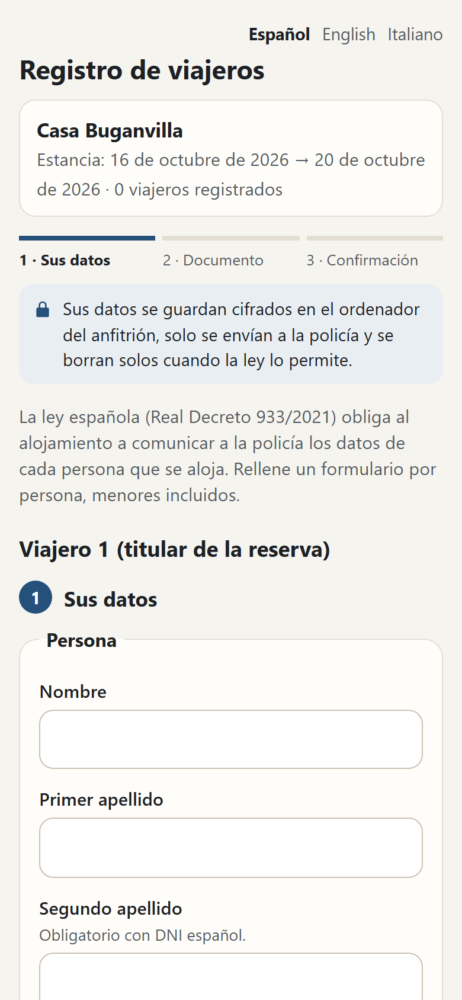
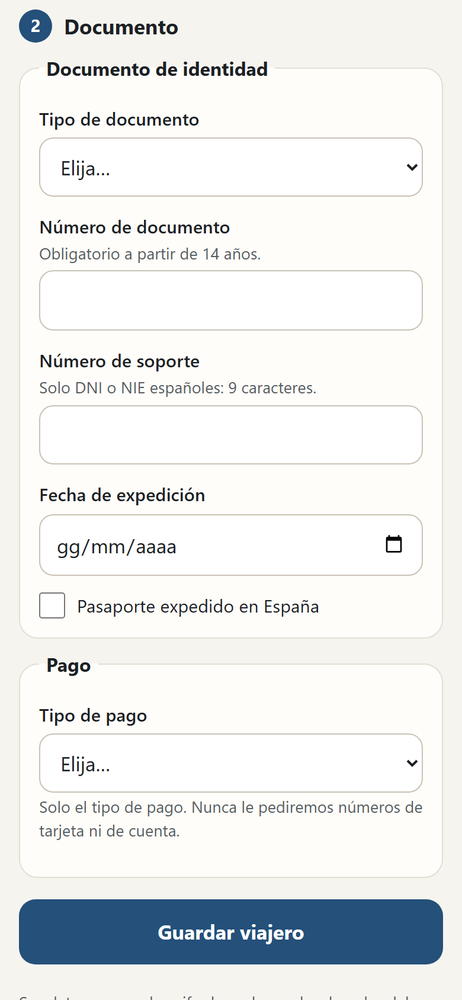
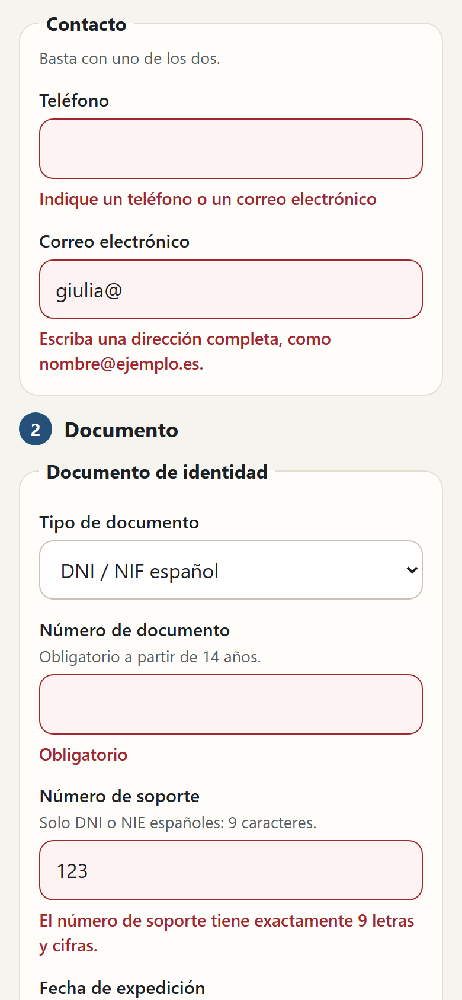
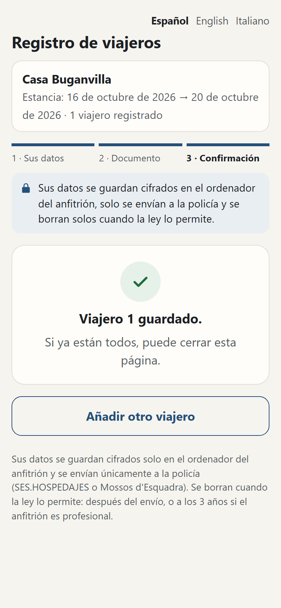

# fairnight-cli

The `fairnight` command:
- reads your Airbnb, Booking and Vrbo calendars and keeps them on your computer;
- gives every night a price and a minimum stay, with the reason behind each;
- shows everything on a calendar page you open in your browser.

The pricing itself is done by the [Fairnight engine](https://github.com/vladIDH/openstay/tree/main/packages/fairnight).

## Five-minute setup

You need [Node.js](https://nodejs.org) 20 or newer.

1. **Install the command and create your folder** (any name, anywhere):
   ```
   npm install -g fairnight-cli
   fairnight init my-rentals
   cd my-rentals
   ```
   This creates three things and nothing else:
   - `fairnight.config.json`: two invented listings to copy from;
   - `data/fairnight.db`: an empty database;
   - `README.txt`: a three-line reminder.

2. **Put your listings in `fairnight.config.json`.** For each listing, give it a short `name`, the iCal links of its calendars, and its price rules (`pricing`).
   - Airbnb: *Calendar → Availability → Connect calendars → Export calendar*.
   - Booking.com: *Rates & availability → Sync calendars → Export calendar*.
   - Vrbo: *Calendar → Import/Export*.

   The price rules are described in the [engine README](https://github.com/vladIDH/openstay/tree/main/packages/fairnight#factors).
   ```json
   {
     "listings": [
       {
         "name": "seaview-loft",
         "calendars": [
           { "source": "airbnb", "url": "https://www.airbnb.com/calendar/ical/….ics?s=…" },
           { "source": "booking", "url": "https://ical.booking.com/v1/export?t=…" }
         ],
         "pricing": { "currency": "EUR", "basePrice": 100, "defaultMinStay": 3, "factors": { } }
       }
     ]
   }
   ```

3. **Read the calendars and open the calendar page:**
   ```
   fairnight sync
   fairnight serve
   ```
   Then open http://localhost:4321.

## Commands

Every command works in the current folder. Add `--dir <folder>` to use another one.

| Command | What it does |
|---|---|
| `fairnight init [folder]` | Creates the folder with the example config, an empty database and a README. Never overwrites a file, so it is safe to run again. |
| `fairnight sync [--listing <name>]` | Downloads the iCal links in the config and stores stays and blocked dates. Running it twice adds nothing. A stay that disappears is marked as removed, not deleted, and comes back if it reappears. If a calendar cannot be read, nothing changes for it. |
| `fairnight import <file.csv> --listing <name> [--dry-run]` | Stores past nightly prices. Columns: date and price, from a Booking/Airbnb export or written by hand. Separators `,` `;` tab `\|`; dates like `2026-11-03` or `03/11/2026`; prices like `92.50`, `92,50` or `€ 1.234,56`. Used by the historical floor. |
| `fairnight price [--listing <name>]` | Prices every night: `--days 365` (default), `--today YYYY-MM-DD`, `--explain` for the full reasoning, `--json` for the data. |
| `fairnight export [--listing <name>] [--format csv]` | Writes `exports/<listing>-<date>.csv` with `date,price,min_stay` for every night for sale, to upload by hand to a channel or channel manager. `--out <file>` chooses the file, `--days` the horizon. |
| `fairnight serve [--port 4321] [--lan]` | The calendar page: one cell per night with price and minimum stay, reserved and blocked nights marked, a click opens the full explanation. *Recalculate* reads the calendars again. With `--lan` you can open it from a phone on the same Wi-Fi. The page speaks Italian, Spanish or English: `"language": "it"` (or `"es"`, `"en"`) at the top of `fairnight.config.json`, English when missing; a small IT · ES · EN menu on the page changes it for that browser. |
| `fairnight smoobu collega` | Asks for your Smoobu API key and secret (nothing typed is shown), checks them on Smoobu and saves them in `smoobu-credentials.json`, readable only by you. |
| `fairnight smoobu importa` | Each Smoobu apartment not linked yet becomes a listing (source `smoobu`, starting prices from Smoobu, to review). Its bookings and blocked dates come in. |
| `fairnight smoobu spingi [--applica] [--da DATE] [--a DATE] [--alloggio ID]` | Compares Smoobu's prices and minimum stays with Fairnight's (default: the next 90 days) and shows the differences. **Writes only with `--applica`**, then reads back from Smoobu to check. |

| `fairnight mercato importa <file> --zona <name>` | Zone data from your own CSV (`date,occupancy,average_price,comparables`) or from the Inside Airbnb files you downloaded (`calendar.csv.gz`, optionally `--annunci listings.csv.gz --tipo "Entire home/apt" --camere 2 --ospiti 4 --quartiere <name>`). With a CSV, `--camere`, `--ospiti`, `--tipo` and `--quartiere` only say which homes your figures describe. `--fonte csv\|insideairbnb` if the type is not recognised, `--dry-run` to check. |
| `fairnight mercato importa --fonte istac --zona <name> --comune <code> [--ospiti N]` | Canary Islands only: the average daily rate of the holiday homes of a municipality (INE code, e.g. `38001` Adeje, `38006` Arona), from ISTAC's open data, for homes of your size (1–4, 5–8, more than 8 guests). Free, one call. |
| `fairnight mercato importa --fonte ine --zona <name> --punto <name>` | The occupancy of the tourist apartments of an INE tourist point (e.g. `Adeje`), as the zone's season. **Off while INE's licence is unclear** (see below). |
| `fairnight mercato prezzo-base [--listing <name>] [--applica]` | The base price the zone data suggests for each listing, and why. Changes nothing; `--applica` writes it for one listing (`--listing`), keeping the old file as `fairnight.config.json.bak`. |
| `fairnight mercato importa --fonte airroi [--zona <name>]` | AirROI zone metrics with your own key, used with AirROI's agreement (see below). `fairnight sync` reads them again every 30 days. |
| `fairnight mercato collega` | Asks for your own AirROI key (never shown) and saves it in `airroi-credentials.json`, readable only by you. Refuses if you switched AirROI off. |
| `fairnight mercato stato` | The zones, their source and attribution, their age, and which listings use them. |
| `fairnight mercato cancella [--zona <name>] [--fonte <source>]` | Deletes zone data on request. |

**About Smoobu:** Smoobu does not publish a CSV format for importing rates, so there is no `--format smoobu`: use the `fairnight smoobu` commands below.

## Smoobu (0.2.0, in development)

The connector uses only Smoobu's **HMAC request signing**: create the key **with its secret** in Smoobu (*Settings → Advanced → API Keys → Create API Key*, then *Generate Secret*). The secret is shown only once. The old key-only login stops working on 31 October 2026 and is not used.

```
fairnight smoobu collega                 # once: key and secret, asked without echo
fairnight smoobu importa                 # apartments become listings, bookings come in
fairnight smoobu spingi                  # dry run: the table of differences, nothing written
fairnight smoobu spingi --applica        # writes, then reads back from Smoobu
```

- **Credentials.** `SMOOBU_API_KEY` and `SMOOBU_API_SECRET` win over the saved file. Neither value is ever printed. Never commit `smoobu-credentials.json`.
- **Reading.** `fairnight sync` (and *Recalculate*) also reads the bookings of listings linked to Smoobu. Blocked dates are unavailable nights, never bookings.
- **Booking day.** For Smoobu listings the stale-calendar discount uses the real day each booking was made.
- **Past prices.** Smoobu gives the total of each stay. Fairnight stores it with its average per night, and uses that average in the historical floor only with `fairnight price --usa-storico-smoobu`, because it is an average per stay, not the price of each night.
- **Writing.** Price and minimum stay always go together. Smoobu does not document whether the end of a date range is included, so Fairnight writes one night per operation until the first real `--applica` has checked it once. After that it uses ranges of up to 7 equal nights.
- **Small hotels.** Smoobu has no room types: one apartment is one bookable unit. A listing with `"units": 4` can list up to 4 Smoobu apartments; Fairnight reads them as the rooms of one room type and writes the same price to the ones still free. The join is Fairnight's, not a Smoobu feature. See [small hotels](../../docs/piccoli-hotel.md).
- **Limits.** At most 300 requests per minute (Smoobu allows 700). It waits when Smoobu says so (429), retries outages, and stops with an explanation on anything else.

## Real output (invented calendars)

```
$ fairnight sync
seaview-loft · airbnb: 3 events · 3 new · 0 changed · 0 removed · 0 back
seaview-loft · booking: 2 events · 2 new · 0 changed · 0 removed · 0 back
garden-studio · vrbo: 3 events · 3 new · 0 changed · 0 removed · 0 back

$ fairnight price --listing seaview-loft --days 10 --today 2026-11-01
seaview-loft · 10 nights from 2026-11-01 · prices in EUR
date        day    price  min  why
2026-11-01  sun       81    1  sun -5%, last minute (≤3 days) -15%
2026-11-02  mon       85    1  last minute (≤3 days) -15%
2026-11-03  tue       85    1  last minute (≤3 days) -15%
2026-11-04  wed        —    —  reserved
…
2026-11-08  sun       84    2  sun -5%, gap of 2 nights -12%
2026-11-09  mon       88    2  gap of 2 nights -12%
2026-11-10  tue        —    —  reserved
5 for sale · 5 reserved · 0 blocked · average 84.60, from 81 to 88

$ fairnight export --listing seaview-loft --today 2026-11-01
seaview-loft: 344 nights for sale written to …/exports/seaview-loft-2026-11-01.csv
```

## Beds24 (0.2.0, in development)

One Fairnight listing is one Beds24 **room**. A room with several identical units (`qty` > 1) becomes a room type with `"units": qty` and one price: bookings are read unit by unit, and `spingi` leaves alone the nights where Beds24's free units (`numAvail`) differ from Fairnight's. See [small hotels](../../docs/piccoli-hotel.md).

```
fairnight beds24 collega                 # once: the invite code, asked without echo
fairnight beds24 importa                 # rooms become listings, bookings come in
fairnight beds24 spingi                  # dry run: the table of differences, nothing written
fairnight beds24 spingi --applica        # writes, lists refused nights, reads back
```

- **Invite code.** Create it in Beds24: *Settings → Marketplace → API → Generate invite code*. Choose the permissions **read:bookings, all:inventory, read:properties** at that moment: they cannot be changed later. The code works once, for 24 hours.
- **Refresh token.** `collega` exchanges the code for a refresh token and saves it in `beds24-credentials.json`, readable only by you. `BEDS24_REFRESH_TOKEN` wins over the file. **A refresh token stops working after 30 days without use.** Short tokens are renewed automatically. No token is ever printed.
- **Which price.** Fairnight writes `price1` unless the listing says otherwise, for example `{ "source": "beds24", "roomId": 1234567, "priceField": "price2" }`. It writes only that field and `minStay`: availability, overrides and the other prices are never touched.
- **Credits.** Beds24 allows 100 credits every 5 minutes by default. Fairnight never goes below half of them, waits for the reset when needed, and prints after each command: `Beds24 credits: 7 used in this run · 93 left of 100 in this 5-minute window.`
- **Bookings.**
  - `confirmed`, `new` and `request` count as bookings; `black` is a blocked date; `cancelled` is removed; enquiries are ignored.
  - The stale-calendar discount uses the real booking time.
  - Stay prices feed the historical floor only with `fairnight price --usa-storico-beds24`, because they are averages per stay.
- **Writing.** One element per night, all in one request per room, until the first real `--applica` has checked once how Beds24 reads the end of a range; then ranges of up to 7 equal nights. Nights Beds24 refuses are listed one by one, and everything is read back.

## Zone data (0.2.0, in development)

Optional. Without zone data, nothing changes: Fairnight prices with your data only.

1. Import a zone: `fairnight mercato importa zona.csv --zona costa`.
2. In `fairnight.config.json`, give the listing its zone and switch the factor on:

```json
{ "name": "seaview-loft", "marketArea": "costa", "calendars": [], "pricing": { "factors": { "market": { "enabled": true } } } }
```

The factor compares each night of the zone with the zone's own average and moves the price by half of the difference, at most +15% or -10% (`weight`, `highPercent`, `lowPercent`, `maxRaisePercent`, `maxLowerPercent`, `withinDays` and `minComparables` change this). `fairnight price --explain` shows the line, with its source.

- **Your own CSV.** For figures you are allowed to use. The first line names the columns, in English, Italian or Spanish. Occupancy is 0–100; one of occupancy or price may be empty.
- **Inside Airbnb.** Only files you download yourself from insideairbnb.com, once; Fairnight never downloads them or visits the site. The data is licensed **CC BY 4.0**: every explanation says "Inside Airbnb (insideairbnb.com), CC BY 4.0". **The occupancy is an estimate**: "not available" means booked *or* closed by the host, and the file cannot tell them apart. Do not republish the data. Not every city is covered (no Canary Islands).
- **AirROI.** Used with AirROI's agreement (15 October 2026). With your own key, for your own pricing, zone metrics only. Optional: zones go under `market.airroi.areas` (`country`, `region`, `locality` as AirROI names them, optional `roomType`, `bedrooms`), the key comes from `AIRROI_API_KEY` or `airroi-credentials.json`, and `"market": { "airroi": { "enabled": false } }` switches it off. Every call is billed to your AirROI account. Wherever the data appears it says "Powered by AirROI" with a link to https://www.airroi.com. The first `fairnight sync` 30 days after the last read reads the zones again (AirROI suggests at least once a month); `fairnight mercato cancella --fonte airroi` deletes the data.
- **ISTAC (Canary Islands).** Open data of the Instituto Canario de Estadística: the average daily rate of the holiday homes of each municipality, month by month, for whole homes of 1–4, 5–8 or more than 8 guests (`--ospiti` chooses the band). Reuse is allowed, also commercial, citing the source: every explanation says "Fuente: Instituto Canario de Estadística (ISTAC)" with the last month of data. ISTAC's figures are monthly and past: each night uses the most recent same month, the zone's season. Import again once a month, not more: ISTAC asks not to repeat requests for the same data.
- **INE (Spain), switched off.** The occupancy of the registered tourist apartments of a tourist point, only as the zone's season (no prices). It stays off until INE's licence is clear: its legal notice says CC BY 4.0, the footer of the same site CC BY-SA 4.0. `"market": { "ine": { "enabled": true } }` switches it on, at your own judgement.
- **Never** scraping of any website.

### Suggested base price

`fairnight mercato prezzo-base` suggests a base price from the zone data: the **median of the monthly average prices** of the zone's homes over the 12 most recent months with figures (at least 6 months; nights measured on fewer than 5 homes are left out). The explanation names the homes (bedrooms, guests, type), the months, the lowest and highest month, your current base price and the source:

```
Suggested base price 118 EUR: median of the monthly average price of 30 homes with 2 bedrooms, 4 guests in zone "costa", 2025-11 → 2026-10 (12 months, from 90 EUR to 145 EUR). Your base price is 100 EUR: +18%. Source: your file "zona.csv", read 2026-11-01. Nothing changes until you confirm it.
```

It says when to check: figures for the whole zone and not homes like yours, a different number of guests (give the listing `"guests": 4`), a suggestion below your floor or above your ceiling, or more than 30% from your price. **The base price never changes by itself**: only with `--applica` for one listing, or with "Use this price" and a confirmation on the calendar page (only on the computer that runs Fairnight; on a phone the page shows the command).

## Guest registration: Fairguest (0.1.0, in development)

In Spain every host must send the police the details of each guest (Real Decreto 933/2021), within 24 hours of the booking and within 24 hours of check-in. `fairnight ospiti` keeps those details **encrypted on your computer**, collects them with a form the guests fill in on a phone or tablet on your own network, reminds you of the deadlines and erases the data when the law allows.

Where the data goes:
- **SES.HOSPEDAJES** for most of Spain (`"country": "ES"`);
- the **Mossos d'Esquadra** for Catalonia (`"country": "ES-CT"`);
- **Alloggiati Web** of the Polizia di Stato for Italy (`"country": "IT"`): the guide is [docs/fairguest-italia.md](../../docs/fairguest-italia.md) (Italian) and [docs/fairguest-italia.es.md](../../docs/fairguest-italia.es.md) (Spanish). In short: `fairnight ospiti credenziali` saves the Alloggiati Web user, password and key sealed; `fairnight ospiti riconosciuto <stay>` records that you saw the guests in person or on a live video call; `fairnight ospiti invia --applica` checks and sends the schedine of today's and yesterday's arrivals; `fairnight ospiti ricevute` keeps the receipts 5 years.

**1. Tell each listing where its guests are communicated.** Add a `fairguest` block in `fairnight.config.json`:

```json
"fairguest": {
  "country": "ES-CT",
  "establishment": "ZZ00000000",
  "establishmentName": "Casa di Prova",
  "professional": false,
  "checkInTime": "16:00",
  "checkOutTime": "10:00",
  "rooms": 1,
  "internet": true
}
```

- `establishment` is the code the authority gave the listing (SES `codigoEstablecimiento`, or the Mossos ID).
- `professional`: `true` if you are registered in the Censo de Empresarios. Professionals keep the register 3 years; everyone else keeps nothing once the communication is confirmed. The default is `false`.

**2. Turn it on and choose a passphrase.**

```
fairnight ospiti attiva
```

The passphrase is asked twice, without echo, and must be at least 12 characters (a few words are easier to remember).

> **If you lose the passphrase, the guests' data cannot be recovered.** Not by you, not by us, not by anyone: there is no reset. Write it down and keep it away from this computer. Change it with `fairnight ospiti frase`, which needs the current one.

**3. Every booking becomes a stay to register.** `fairnight sync` does this for bookings that end today or later, from your iCal links, Smoobu or Beds24:
- the iCal links give only dates and listing;
- Smoobu and Beds24 also give the holder's name, the number of guests and the booking reference. Those go **only** into the encrypted Fairguest tables, never into the calendar tables or the output.

**4. The guests fill in the form.**

```
fairnight serve --lan
fairnight ospiti elenco
```

`elenco` lists each stay with its form path, for example `/checkin/Xb3…`. Open `http://<this computer>:4321/checkin/Xb3…` on a phone or tablet on the same Wi-Fi.

- The form opens **only from the local network**. Other addresses are refused, and so is anything that comes through a proxy or tunnel. The code stops working after check-out.
- It is in Spanish, English and Italian, made for a phone first, light or dark like the guest's phone.
- Three steps on screen: the guest's details, the document, then a confirmation with "Add another guest". One line at the top says what happens to the data: encrypted on your computer, sent only to the police, erased by itself when the law allows.
- It asks what the decree asks for, one guest at a time, and says next to each field what is missing or wrong (a date in the future, a support number that is not 9 characters…).
- It asks only for the **type** of payment. There is no field for a card number or an IBAN, and any such field sent to the server is thrown away.
- Each guest is encrypted as soon as it arrives. The server does not know your passphrase and cannot read back what it saved.

| Step 1: details | Step 2: document | A field to fix | Confirmation |
|---|---|---|---|
|  |  |  |  |

The same screens in Italian, on a computer and in dark mode are in [docs/images/visivo](../../docs/images/visivo). All data in them is invented.

**5. Send, and record it.**

```
fairnight ospiti                         # what is due, late or open (exit code 1 when something is late)
fairnight ospiti mostra <stay>           # the data and what is still missing (asks the passphrase)
fairnight ospiti prepara <stay>          # Catalonia: writes data/fairguest/<ID>.001 to upload on the Mossos portal
fairnight ospiti inviato <stay> --tipo checkin
```

- **Catalonia:** upload the file on registreviatgers.mossos.gencat.cat (*Envío de ficheros masivos*), then record it with `inviato`. The file holds the guests' data in clear, so it is deleted at that moment.
- **Rest of Spain:** sending to SES.HOSPEDAJES is **not written yet**, because it needs the Ministry's XSD schemas, which are published only inside the SES application. `prepara` says so and stops. Until then, enter the guests on the SES website and record it with `inviato`.

**Corrections and guests' requests.**

```
fairnight ospiti correggi <stay> pagamento                # the new value is asked, never typed on the command line
fairnight ospiti correggi <stay> address.municipalityCode --persona 1
fairnight ospiti esporta <stay> --persona 1 --out data.json
fairnight ospiti cancella <stay> --persona 2 --applica
fairnight ospiti pulisci                                  # apply the retention rules now, and show each stay's rule
```

The INE code of the municipality, needed for guests who live in Spain, is not asked in the form: guests rarely know it. Add it with `correggi`.

**Retention runs by itself** at every `fairnight ospiti` command, at every `sync` and when `serve` starts. It deletes the guests, the encrypted details, the form link and any file, and keeps only dates and the record of what was sent. Backups and copies of `data/fairnight.db` are not touched: erasing works only on the file itself.

The MCP server has a read-only tool, `get_guest_deadlines`, that answers "what do I still have to send?" with dates and states only.

## Replies to guests: Fairhello (0.1.0, in development)

`fairnight risposte` (also `fairnight hello`) reads your guests' messages from Smoobu or Beds24 and writes a draft reply for each guest waiting for an answer. **Every reply is approved by you**; nothing is sent on its own.

```
fairnight risposte collega                 # Anthropic with your own key, or Ollama on this computer
fairnight risposte casa --listing loft     # writes casa/loft.md with a few questions
fairnight risposte leggi                   # new messages and drafts [--senza-bozze]
fairnight risposte                         # the replies to approve, with their number
fairnight risposte mostra 3                # the conversation and draft 3
fairnight risposte invia 3                 # shows what would be sent
fairnight risposte invia 3 --applica       # sends it
fairnight risposte scarta 3
fairnight risposte stato                   # model, house files, tokens used in 30 days
```

Or on the page **http://localhost:4321/risposte** of `fairnight serve`: the conversation, the draft in a box you can change, *Approve and send* and *Discard*. The page opens **only on this computer**, even with `--lan`.

**The house file** `casa/<listing>.md` is plain Markdown: a `#` title, then one `##` section per topic (check-in, wifi, parking, rules…). A section called `## Codici d'accesso`, `## Códigos de acceso` or `## Access codes` is given to the model only from the day of check-in to the day of check-out, and only after the guest registration if the listing uses Fairguest. Without the file, no draft is written for that listing.

**What the model gets**: the house file, the dates and times of the stay, the guest's language, whether the registration is done, the free nights just before and after the stay (dates only), and the last 20 messages. **Never prices** and never the guest's name or contact details. A draft that contains an amount of money anyway cannot be sent until you change it.

**Before sending**, the conversation is read again from Smoobu or Beds24. A draft is sent only if it still answers the guest's last message, the booking is not cancelled and the stay ended at most 2 days ago. It is sent once, even after a double click.

**Settings** in `fairhello.json`:

```json
{
  "provider": "anthropic",
  "model": "claude-haiku-5-5",
  "signature": "Marta",
  "retentionDays": 60,
  "maxDraftsPerRun": 20
}
```

For Ollama: `"provider": "ollama"`, `"model": "qwen3:8b"` (or any model you pulled) and, if it is not the default, `"ollamaUrl": "http://127.0.0.1:11434"`. The Anthropic key is in `ANTHROPIC_API_KEY` or in `fairhello-credentials.json`, readable only by you. Never share that file.

**Beds24** sends messages only for bookings that came from a channel, and the invite code needs the **bookings-personal** scope with write access. Messages are erased `retentionDays` after check-out. The MCP server has a read-only tool, `get_guest_replies`. The full guide, in Italian, is [docs/risposte-ospiti.md](../../docs/risposte-ospiti.md).

## How calendars are read

- **Airbnb**: "Reserved" counts as a stay; "Airbnb (Not available)" counts as a blocked date.
- **Booking.com**: the export does not tell stays from closed dates, so every event counts as a stay.
- **Vrbo**: "Blocked" or "Unavailable" counts as a blocked date; everything else is a stay.
- **Other**: "not available", "unavailable", "blocked" or "closed" counts as a blocked date.

If a calendar is read the wrong way, set `"treatAs": "reservation"` or `"treatAs": "blocked"` on it.

On a room type of a small hotel (`"units"` > 1 in the pricing) each calendar belongs to one room and says which: `{ "source": "airbnb", "url": "…", "unit": "101" }`. Two calendars of the same room share it, so the room counts once. A calendar of a whole room type is not accepted (Booking.com does not even offer one). See [small hotels](../../docs/piccoli-hotel.md).

Calendars do not say when a booking was made. Fairnight counts a booking as new on the day `fairnight sync` first sees it, and the stale-calendar discount uses that date. Run `sync` often, for example every few hours with the Windows Task Scheduler or cron. Right after the first sync every stay looks new, so the discount waits.

## Where your data lives

Everything stays in your folder:
- `fairnight.config.json` holds your rules and your iCal links. Treat those links like passwords: anyone who has one can read that calendar.
- `data/fairnight.db` is a single SQLite file. It holds stay dates, blocked dates and imported prices; the calendars' guest names, phone numbers and descriptions are never stored there. If you turn on guest registration, the guests' details are in the same file, **encrypted** with a key only your passphrase opens (see above).
- `exports/` holds the CSV files you asked for.

The only network requests go to the iCal links you wrote (and to Smoobu or Beds24, if you connect them). The calendar page listens only on your computer unless you add `--lan`, and even then only devices on your own network can open it. No accounts, no telemetry. To back up, copy the folder. To start over, delete it.

## License

AGPL-3.0-only. See [LICENSE](LICENSE).
